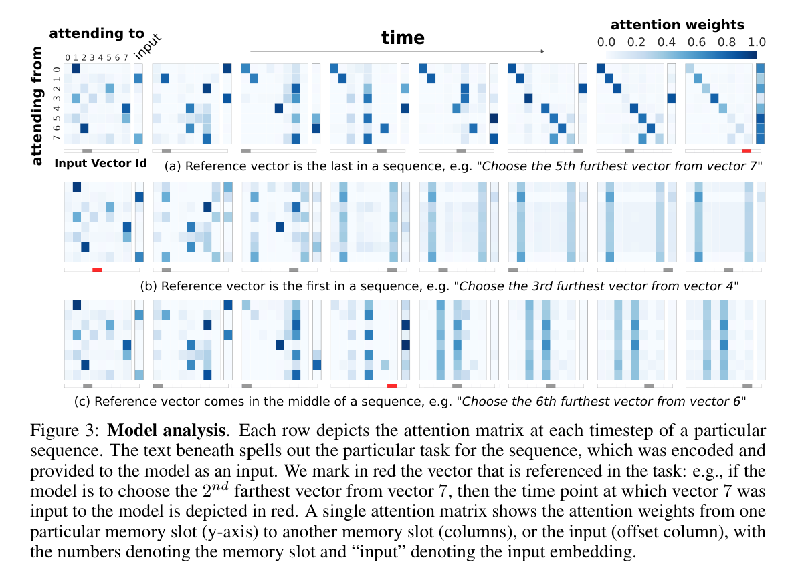

# 5.2 Program Evaluation

> Section 15 of 25 from [18 - Relational Recurrent Neural Networks](../../papers/18-relational-recurrent-neural-networks.md) · `other` · pages 5-6

Program evaluation performance was assessed via the Learning to Execute tasks \[25\]. We evaluated a number of baselines alongside the RMC including an LSTM \[3, 37\], DNC \[5\], and a bank of LSTMs resembling Recurrent Entity Networks \[38\] (EntNet) - the configurations for each of these is described in the appendix. Best test batch accuracy results are shown in Table 1. The RMC performs at least as well as all of the baselines on each task. It is marginally surpassed by a small fraction of performance on the double memorization task, but both models effectively solve this task. Further, the results of the RMC outperform all equivalent tasks from \[25\] which use teacher forcing even when evaluating model performance. It’s worth noting that we observed better results when we trained in a

3Project Gutenberg. (n.d.). Retrieved January 2, 2018, from www.gutenberg.org

## attention weights

## attending to

## time

input

## attending from

---

Full document: [18 - Relational Recurrent Neural Networks](../../papers/18-relational-recurrent-neural-networks.md) · Page-level evidence: [paper-pages/18-relational-recurrent-neural-networks](../../paper-pages/18-relational-recurrent-neural-networks/index.md)
