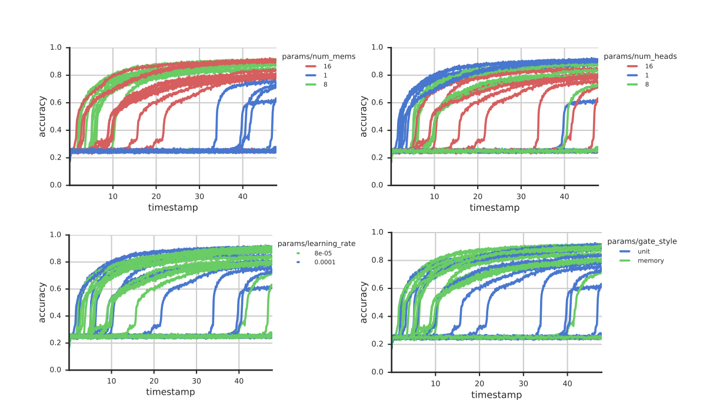
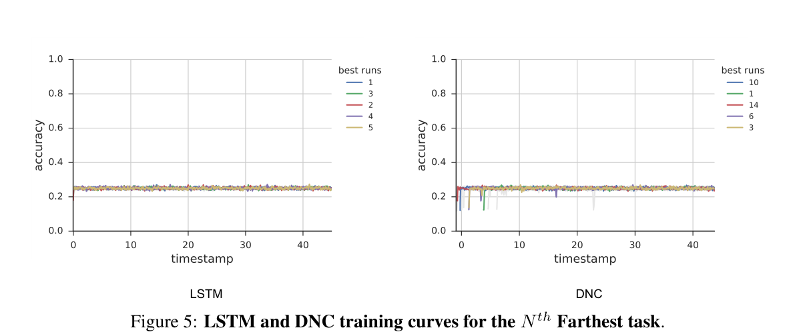
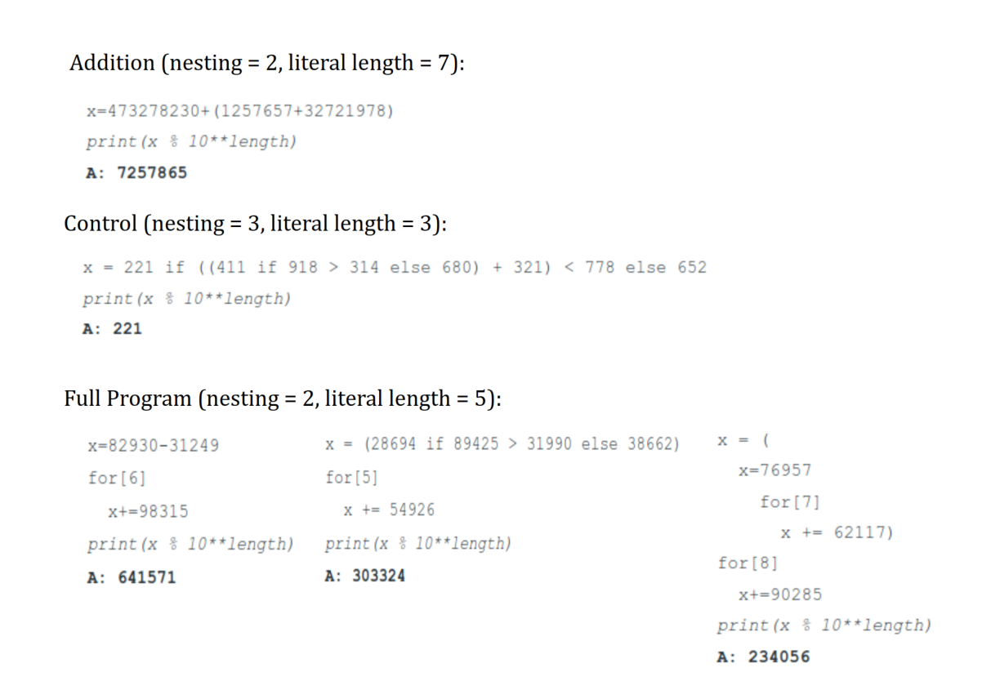
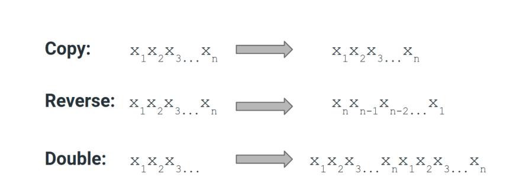

# A.2 Program Evaluation

> Section 22 of 25 from [18 - Relational Recurrent Neural Networks](../../papers/18-relational-recurrent-neural-networks.md) · `other` · pages 12-14

To further study the effect of relational structure on working memory and symbolic representation we turned to a set of problems that provided insights into the RMC’s fitness as a generalized computational model. The Learning to Execute (LTE) dataset \[25\] provided a good starting point for assessing the power of our model over this class of problems. Sample problems are of the form of linear time, constant memory, mini-programs.

Training samples were generated in batches of 128 on-the-fly. Each model was trained for 200K iterations using an Adam optimiser and learning rate of 1e−3. The samples were parameterized by literal length and nesting depth which define the length of terminal values in the program snippets and the level of program operation nesting. Within each batch the literal length and nesting value was sampled uniformly up to the maximum value for each - this is consistent with the Mix curriculum strategy from \[25\]. We evaluated the model against a batch of 12800 samples using the maximum nesting and literal length values for all samples and report the top score. Examples of samples for each task can be found in figure 6 and figure 7. It also worth noting that the modulus operation was applied to addition, control, and full program samples so as to bound the output to the maximum literal length in case of longer for-loops.

The sequential model consists of an encoder and a decoder which each take the form of a recurrent neural network \[45, 25\]. Once the encoder has processed the input sequence the state of the encoder is used to initialize the decoder state and subsequently to generate the target sequence (program output). The output from all models is passed through a 4-layer MLP - all layers have size 256 with an output ReLU - to generate an output embedding at each step of the output sequence.

In \[25\] teacher forcing is used for both training and testing in the decode phase. For our experiments, we began by exploring teacher forcing during training but used model predictions from the previous step as input to the the decoder at the next step when evaluating the model \[45\]. We also considered the potential effect of limiting

Figure 4: N th Farthest hyperparameter analysis. Timestamp refers to hours of training. There is a clear effect with the number of memories, with 8 or 16 memories being better than 1. Interestingly, when the model had 1 memory we observed an effect with the number of heads, with more heads (8 or 16) being better than one, possibly indicating that the RMC can learn to compartmentalise and relate information across heads in addition to across memories.

LSTM DNC

Figure 5: LSTM and DNC training curves for the N th Farthest task.

the dependency on the ground truth altogether when training the decoder \[39\] and using a non-auto-regressive regime where model predictions only were used during training. It turned out that this approach tended to yield the strongest results.

Following are the encoder/decoder configurations for a collection of memory models that performed best over all tasks. With the RMC we swept over two and four memories, and two and four attention heads, a total memory size of 1024 and 2048 (divided across memories), a single pass of self attention per step and scalar memory gating. For the baselines, the LSTM is a two layer model and we swept over models with 1024 and 2048 units per layer, skip connections and layer-wise outputs concatenated on the final layer. The DNC used a memory size of 80, word size 64, four read heads and one write head, a 2-layer controller sweeping over 128, 256 and 512 latent units per layer, larger settings than this tended to hurt performance. Also for the DNC, an LSTM controller is used for Program Evaluation problems, and feed-forward controller for memorization. Finally, the EntNet was compared with a total memory size of either 1024 or 2048 with 2, 4, 6, or 8 memory cells where total memory size is divided among memories and the states of the cells are summed to produce an output. All results reported are from the strongest performing hyper-parameter setting for the given model.

Figure 6: Samples of programmatic tasks. Note that training samples will sample literal length up to including the maximum length.

Figure 7: Memorization tasks. Each sub-task takes the form of a list permutation.

As seen in figure 8 the RMC tends to quickly achieve high performance relative to the baselines, this demonstrates good data efficiency for these tasks especially when compared to the LSTM. From the same figure and table 1 (the results in the table depict converged accuracy scores for nesting 2 and literal length 5) it is also clear that the RMC scores well among the full set of program evaluation tasks where the DNC faltered on the control task and the EntNet on copy and double tasks. It should finally be noted that due to the RMC model size scaling with respect to total memory size over number of memories and consequently the top performing LSTM models contained many more parameters than the top performing RMC models.

---

Full document: [18 - Relational Recurrent Neural Networks](../../papers/18-relational-recurrent-neural-networks.md) · Page-level evidence: [paper-pages/18-relational-recurrent-neural-networks](../../paper-pages/18-relational-recurrent-neural-networks/index.md)
