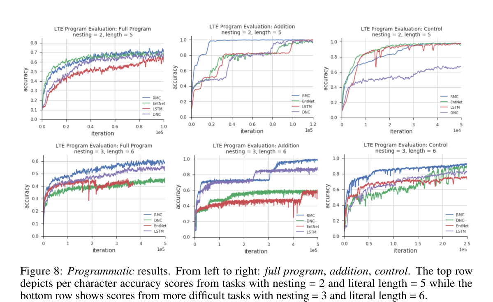
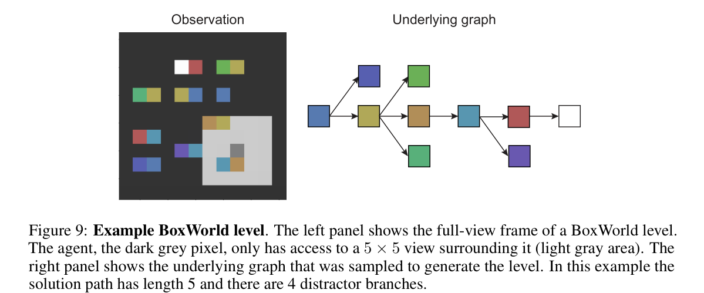
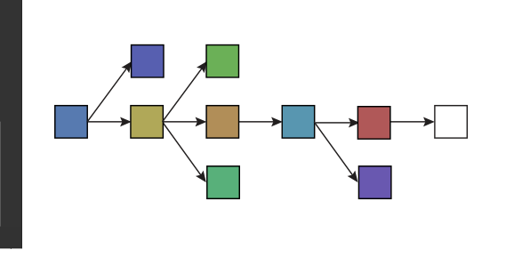
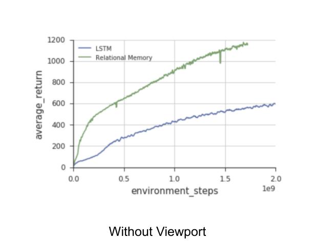

# A.3 Viewport BoxWorld

> Section 23 of 25 from [18 - Relational Recurrent Neural Networks](../../papers/18-relational-recurrent-neural-networks.md) · `other` · pages 14-16

We study a variant of BoxWorld, which is a pixel-based, highly combinatorial reinforcement learning environment that demands relational reasoning-based planning, initially developed in \[46\]. It consists of a grid of 14 × 14 pixels: grey pixels denote the background, lone colored pixels are keys that can be picked up, and duples of colored pixels are locks and keys, where the right pixel of the duple denotes the color of the lock (and hence the color of the key that is needed to open the lock), and the left pixel denotes the color of the key that would be obtained should the agent open the lock. The agent is denoted by a dark grey pixel, and has four actions: up, down, left, right. To make this task demand relational reasoning in a memory space, the agent only has perceptual access to a 5 × 5 RGB window, or viewport, appended with an extra frame denoting the color of the

Figure 8: Programmatic results. From left to right: full program, addition, control. The top row depicts per character accuracy scores from tasks with nesting = 2 and literal length = 5 while the bottom row shows scores from more difficult tasks with nesting = 3 and literal length = 6.

Underlying graph Observation

Figure 9: Example BoxWorld level. The left panel shows the full-view frame of a BoxWorld level. The agent, the dark grey pixel, only has access to a 5 × 5 view surrounding it (light gray area). The right panel shows the underlying graph that was sampled to generate the level. In this example the solution path has length 5 and there are 4 distractor branches.

key currently in possession. The goal of the task is to navigate the space, observe the key-lock combinations, and then choose the correct key-lock sequence so as to eventually receive the rewarded gem, denoted by a white pixel.

In each level there is a unique sequence of keys-lock pairs that should be traversed to reach the gem. There are a few important factors that make this task difficult: First, keys disappear once they are used. Since we include ‘distractor’ branches (i.e., key lock paths that lead to a dead end), the agent must be able to look ahead, and

reason about the appropriate path forward to the gem so as to not get stuck. Second, the location of the keys and locks are randomised, making this task completely devoid of any spatial biases. This emphasises a capacity to reason about the relations between keys and locks, in memory, based on their abstract relations, rather than based on their spatial positions. For this reason we suspect that CNN-based approaches may struggle, since their inductive biases are tied to relating things proximal in space.

To collect a locked key the agent must be in possession of the matching key color (only one key can be held at a time) and walk over the lock, after which the lock disappears. Only then is it possible for the agent to pick up the adjacent key. Each level was procedurally generated, constrained to have only one unique sequence in each level ending with the white gem. To generate the level we first sampled a random graph (tree) that defined the possible paths that could be traversed, including distractor paths. An example path is shown in figure 9.

With viewport Without Viewport

Figure 10: Mini Pacman Results.

We used a total of 20 keys and 20 locks (i.e., colors) in our sampling pool to produce each level. Three main factors determined the difficulty of the level: (1) the path length (i.e., number of locks) to the gem; (2) the number of distractor branches; and (3) the path lengths of the distractor branches. For training we used solution path lengths of at least 1 and up to 5, ensuring that an untrained agent would have a small probability of reaching the goal by chance, at least on the easier levels. We sampled the number of distractor branches to be between 0 and 5, with a length of 1.

The viewport observation was processed through two convolutional layers, with 12 and 24 kernels, and with 2 × 2 kernel sizes and a stride of 1. Each layer used a ReLU non-linearity. We used two extra feature maps to tag the convolutional output with absolute spatial position (x and y) of each pixel/cell, with the tags comprising evenly spaced values between −1 and 1. The resulting stack was then passed to the RMC, containing four memories, four heads, a total memory size of 1024 (divided across heads and memories), a single pass of self attention per step and scalar memory gating. For the baseline, we replaced the RMC with a 5 × 5 ConvLSTM with 64 output channels, with 2 × 2 kernels and stride of 1.

We used this architecture in an actor-critic set-up, using the distributed Importance Weighted Actor-Learner Architecture \[47\]. The agent consists of 100 actors, which generate trajectories of experience, and one learner, which directly learns a policy π and a baseline function V , using the actors’ experiences. The model updates were performed on GPU using mini-batches of 32 trajectories provided by the actors via a queue. The agent had an entropy cost of 0.005, discount (γ) of 0.99 and unroll length of 40 steps. The learning rate was tuned, taking values between 1e−5 and 2e−4. Informally, we note that we could replicate these results using an A3C setup, though training took longer.

The agent received a reward of +10 for collecting the gem, +1 for opening a box in the solution path and −1 for opening a distractor box. The level was terminated immediately after collecting the gem or opening a distractor box.

---

Full document: [18 - Relational Recurrent Neural Networks](../../papers/18-relational-recurrent-neural-networks.md) · Page-level evidence: [paper-pages/18-relational-recurrent-neural-networks](../../paper-pages/18-relational-recurrent-neural-networks/index.md)
