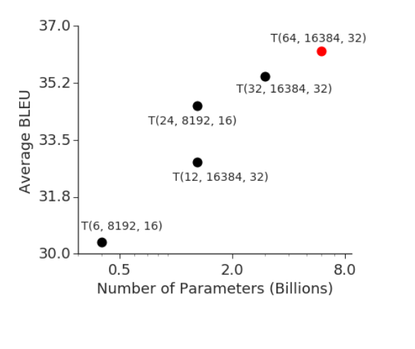
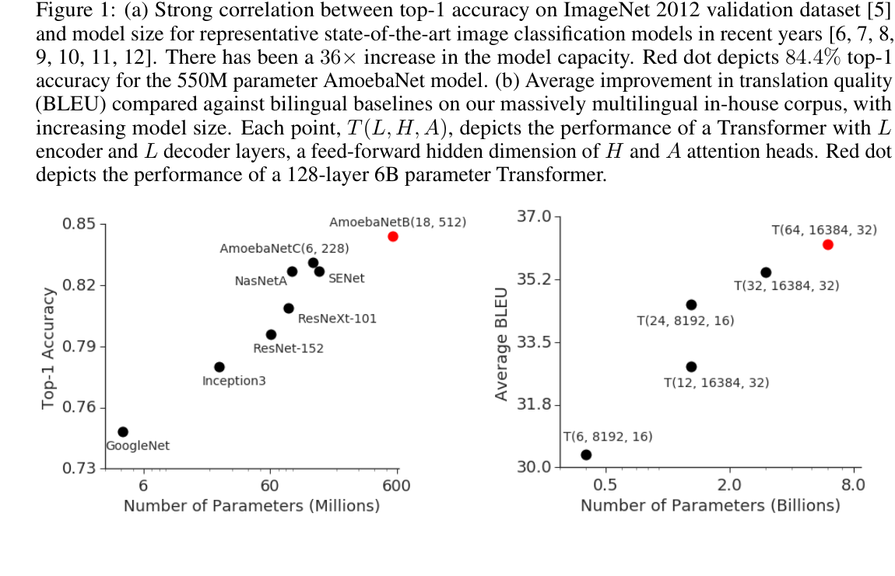

# 1 Introduction

> Section 4 of 14 from [19 - GPipe: Easy Scaling with Micro-Batch Pipeline Parallelism](../../papers/19-gpipe-pipeline-parallelism.md) · `introduction` · pages 1-1

Deep learning has seen great progress over the last decade, partially thanks to the development of methods that have facilitated scaling the effective capacity of neural networks. This trend has been most visible for image classification, as demonstrated by the accuracy improvements on ImageNet with the increase in model capacity (Figure 1a). A similar phenomenon can also be observed in the context of natural language processing (Figure 1b) where simple shallow models of sentence representations \[1, 2\] are outperformed by their deeper and larger counterparts \[3, 4\].

While larger models have brought remarkable quality improvements to several fields, scaling neural networks introduces significant practical challenges. Hardware constraints, including memory limitations and communication bandwidths on accelerators (GPU or TPU), force users to divide larger

Preprint. Under review.

Figure 1: (a) Strong correlation between top-1 accuracy on ImageNet 2012 validation dataset \[5\] and model size for representative state-of-the-art image classification models in recent years \[6, 7, 8, 9, 10, 11, 12\]. There has been a 36× increase in the model capacity. Red dot depicts 84.4% top-1 accuracy for the 550M parameter AmoebaNet model. (b) Average improvement in translation quality (BLEU) compared against bilingual baselines on our massively multilingual in-house corpus, with increasing model size. Each point, T(L, H, A), depicts the performance of a Transformer with L encoder and L decoder layers, a feed-forward hidden dimension of H and A attention heads. Red dot depicts the performance of a 128-layer 6B parameter Transformer.

models into partitions and to assign different partitions to different accelerators. However, efficient model parallelism algorithms are extremely hard to design and implement, which often requires the practitioner to make difficult choices among scaling capacity, flexibility (or specificity to particular tasks and architectures) and training efficiency. As a result, most efficient model-parallel algorithms are architecture and task-specific. With the growing number of applications of deep learning, there is an ever-increasing demand for reliable and flexible infrastructure that allows researchers to easily scale neural networks for a large variety of machine learning tasks.

To address these challenges, we introduce GPipe, a flexible library that enables efficient training of large neural networks. GPipe allows scaling arbitrary deep neural network architectures beyond the memory limitations of a single accelerator by partitioning the model across different accelerators and supporting re-materialization on every accelerator \[13, 14\]. With GPipe, each model can be specified as a sequence of layers, and consecutive groups of layers can be partitioned into cells. Each cell is then placed on a separate accelerator. Based on this partitioned setup, we propose a novel pipeline parallelism algorithm with batch splitting. We first split a mini-batch of training examples into smaller micro-batches, then pipeline the execution of each set of micro-batches over cells. We apply synchronous mini-batch gradient descent for training, where gradients are accumulated across all micro-batches in a mini-batch and applied at the end of a mini-batch. Consequently, gradient updates using GPipe are consistent regardless of the number of partitions, allowing researchers to easily train increasingly large models by deploying more accelerators. GPipe can also be complemented with data parallelism to further scale training.

We demonstrate the flexibility and efficiency of GPipe on image classification and machine translation. For image classification, we train the AmoebaNet model on 480 × 480 input from the ImageNet 2012 dataset. By increasing the model width, we scale up the number of parameters to 557 million and achieve a top-1 validation accuracy of 84.4%. On machine translation, we train a single 128-layer 6-billion-parameter multilingual Transformer model on 103 languages (102 languages to English). We show that this model is capable of outperforming the individually trained 350-million-parameter bilingual Transformer Big \[15\] models on 100 language pairs.

---

Full document: [19 - GPipe: Easy Scaling with Micro-Batch Pipeline Parallelism](../../papers/19-gpipe-pipeline-parallelism.md) · Page-level evidence: [paper-pages/19-gpipe-pipeline-parallelism](../../paper-pages/19-gpipe-pipeline-parallelism/index.md)
