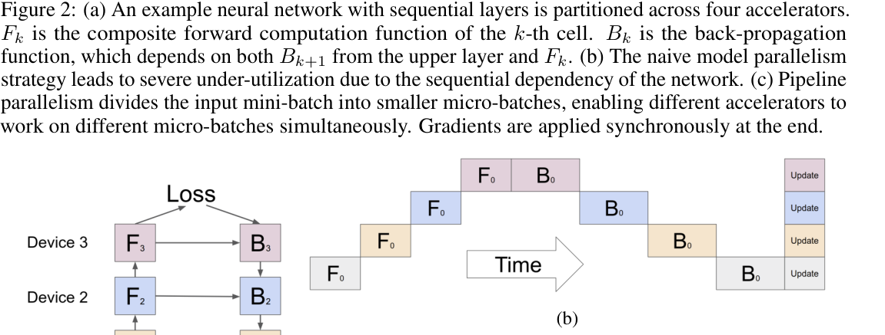
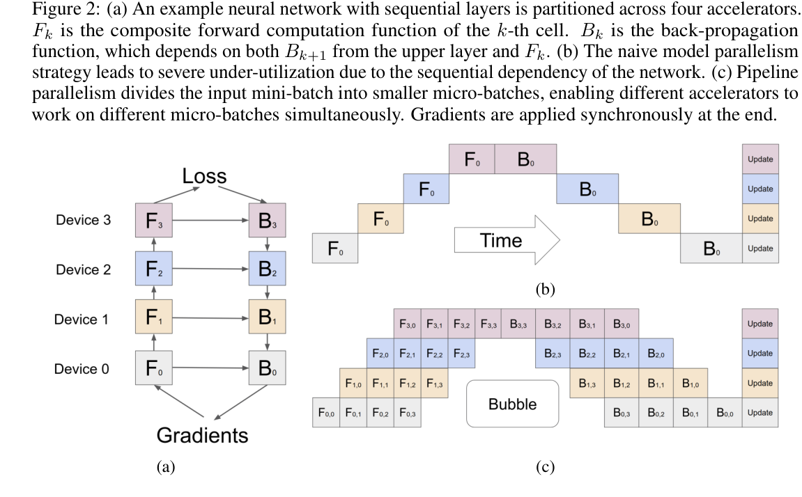
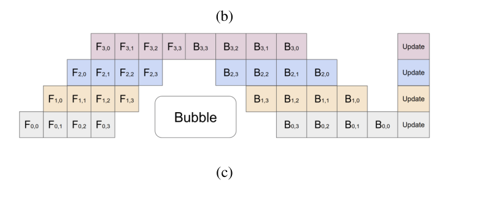

# 2 The GPipe Library

> Section 5 of 14 from [19 - GPipe: Easy Scaling with Micro-Batch Pipeline Parallelism](../../papers/19-gpipe-pipeline-parallelism.md) · `method` · pages 1-2

We now describe the interface and the main design features of GPipe. This open-source library is implemented under the Lingvo \[16\] framework. The core design features of GPipe are generally applicable and can be implemented for other frameworks \[17, 18, 19\].

Figure 2: (a) An example neural network with sequential layers is partitioned across four accelerators. Fk is the composite forward computation function of the k-th cell. Bk is the back-propagation function, which depends on both Bk+1 from the upper layer and Fk. (b) The naive model parallelism strategy leads to severe under-utilization due to the sequential dependency of the network. (c) Pipeline parallelism divides the input mini-batch into smaller micro-batches, enabling different accelerators to work on different micro-batches simultaneously. Gradients are applied synchronously at the end.

(b)

(a)

(c)

---

Full document: [19 - GPipe: Easy Scaling with Micro-Batch Pipeline Parallelism](../../papers/19-gpipe-pipeline-parallelism.md) · Page-level evidence: [paper-pages/19-gpipe-pipeline-parallelism](../../paper-pages/19-gpipe-pipeline-parallelism/index.md)
