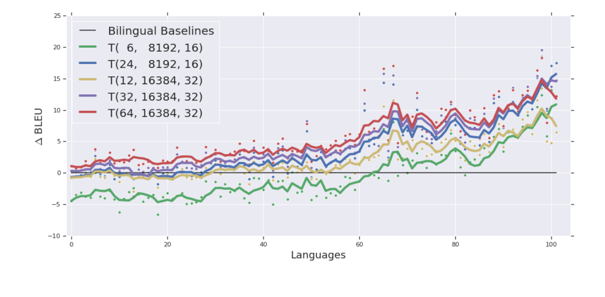

# 5 Massive Massively Multilingual Machine Translation

> Section 11 of 14 from [19 - GPipe: Easy Scaling with Micro-Batch Pipeline Parallelism](../../papers/19-gpipe-pipeline-parallelism.md) · `other` · pages 5-7

Next, we demonstrate the flexibility of GPipe by scaling up models used for Natural Language Processing (NLP). Due to an abundance of available parallel corpora, neural machine translation (NMT) has become a benchmark task for any architecture used for NLP \[33, 15, 34, 35, 36\]. For this reason, we continue our GPipe experiments on a large-scale multilingual NMT task. We use a corpus of parallel documents over 102 languages and English, containing a total of 25 billion training examples, ranging from 104 to 109 per language \[37\]. This dataset creates a realistic test bed for experiments on scalability by spanning a diverse set of languages from data-scarce (low-resource) to data-rich (high-resource). For the first time in machine translation, we show that a large enough NMT model can learn the mapping between more than 100 language pairs simultaneously, while achieving better than bilingual model performance for all languages. This further brings out the importance of having efficient and flexible model-parallelism tools.

Our comparison is based on the performance of a single Transformer \[15\] trained on all language pairs in this corpus. We scale the architecture along two dimensions to stress the flexibility of GPipe: (i) along the depth by increasing the number of layers in the model and (ii) along the width by increasing the hidden dimension in the feed-forward layers and the number of attention heads (as well as # attention channels) in multi-head attention layers similar to Shazeer et al. \[34\]. Please refer to the supplementary material for a detailed description of our dataset, baselines, training configuration and optimization hyper-parameters.

We start with a standard 400M-parameter Transformer Big model, T(6, 8192, 16)1, as described in Chen et al. \[35\], with a vocabulary size of 64k. In Figure 3, we compare its performance against a 1.3B-parameter deep model, T(24, 8192, 16), a 1.3B-parameter wide model, T(12, 16384, 32), a 3Bparameter model, T(32, 16384, 32) and a 6B-parameter model, T(64, 16384, 32). All of the models are trained on all language pairs simultaneously, using temperature-based sampling as employed for multilingual BERT2 \[3\]. T(12, 16384, 32), T(24, 8192, 32), T(32, 16384, 32) and T(64, 16384, 32) are partitioned over 2, 4, 8 and 16 accelerators respectively.

1T(L, H, A) is a Transformer model with L encoder layers and L decoder layers, a feed-forward hidden dimension of H and A attention heads. The model dimension is fixed to 1024.

2https://github.com/google-research/bert/blob/master/multilingual.md

From Figure 3, we can observe that increasing the model capacity from 400M to 1.3B parameters significantly improves performance across all languages. Scaling up the model from 1.3B parameters to 6B parameters shows further improvement, especially for high-resource languages, although diminishing returns can be observed when scaling the model from 1.3B to 3B and 6B parameters.

Below we discuss some of our empirical findings based on these large-scale experiments.

Figure 3: Translation quality across all languages with increasing multilingual model capacity. Languages are arranged in the order of decreasing training dataset size from left to right. T(L, H, A), depicts the performance of a Transformer with L encoder and L decoder layers, a feed-forward hidden dimension of H and A attention heads. We notice that increasing the model capacity, from 400M params (T(6, 8192, 16)) to 1.3B (T(24, 8192, 16)), and further, to 6B (T(64, 16384, 32)), leads to significant quality improvements across all languages. We also notice huge quality improvements for low-resource languages (right side of the plot), when compared against bilingual baselines, highlighting the significant transfer gains resulting from training a multilingual model.

Depth-Width Trade-off: We study the trade-off between depth and width in our multilingual setup and compare the performance of 1.3B wide model T(12, 16384, 32) and 1.3B deep model T(24, 8192, 16). While the quality of these two models on high-resource languages (left of Figure 3) is very similar, the deeper model outperforms by huge margins on low-resource languages, suggesting that increasing model depth might be better for generalization. Further, the quality improvements for low-resource languages (right side of Figure 3), when comparing the 1.3B deep model against the 400M model, are almost as large as the improvements for high-resource languages, indicating that increasing depth might potentially increase the extent of transfer to low-resource tasks.

Trainability Challenges with Deep Models: Although depth increases the representational capacity of neural networks, it also complicates the optimization problem. In our large-scale experiments, we encountered severe trainability issues arising from a combination of sharp activations (positive kurtosis) and dataset noise. We observed that after training for a few thousand steps, the model predictions would become extremely peaky and vulnerable to noise, which frequently resulted in non-finite or large gradients that eventually destroyed the learning progress. To counter these problems, we apply two methods: (i) Following Zhang et al. \[38\], we scale down the initialization of all transformer feed-forward layers by the number of layers. (ii) We clip the logit predictions (softmax pre-activations) whenever their magnitude exceeds a certain value.

A combination of these two approaches allows us to mitigate the training instability posed by scaling model depth.

Table 5: The Effect of Batch Size

Large Batches: Due to its simplicity, data parallelism is the dominant approach to scale neural network training\[39, 40\]. We test the limits of large-batch training by significantly increasing the batch size used for standard Transformer Big training. Starting from 260K tokens per batch,

Batch Size 260K 1M 4M BLEU 30.92 31.86 32.71 Loss (NLL) 2.58 2.51 2.46

we increase the effective batch size to 4M and observe the validation loss and BLEU scores on the high-resource language pair, German-English (similar trend can also be observed for other language pairs). Optimization parameters used here are identical to those for previous experiments. To our knowledge, 4M tokens per batch is the largest batch size that has ever been used in literature to date for training NMT models \[41\]. Table 5 shows that both metrics improve significantly as we increase the batch size. We believe further increasing batch size can potentially yield more improvement.

---

Full document: [19 - GPipe: Easy Scaling with Micro-Batch Pipeline Parallelism](../../papers/19-gpipe-pipeline-parallelism.md) · Page-level evidence: [paper-pages/19-gpipe-pipeline-parallelism](../../paper-pages/19-gpipe-pipeline-parallelism/index.md)
