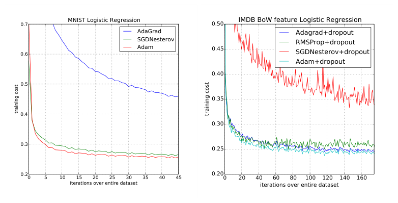
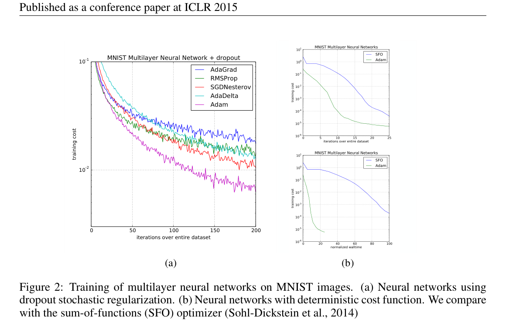
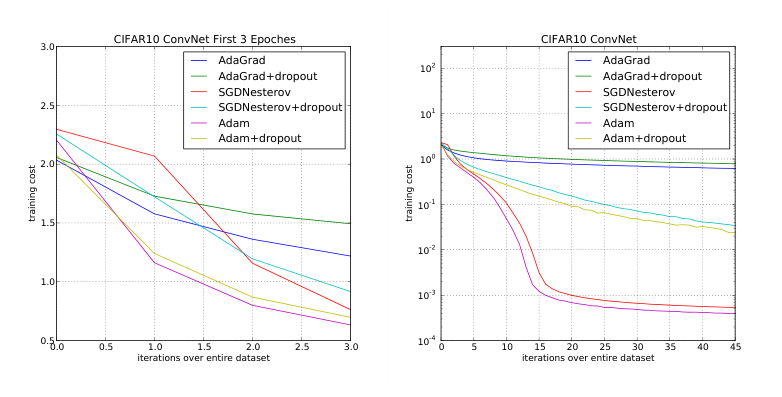
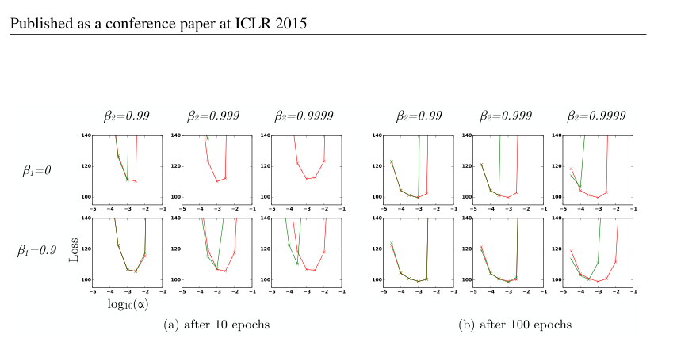

# 6 EXPERIMENTS

> Section 8 of 13 from [20 - Adam: A Method for Stochastic Optimization](../../papers/20-adam-stochastic-optimization.md) · `experiments` · pages 4-7

To empirically evaluate the proposed method, we investigated different popular machine learning models, including logistic regression, multilayer fully connected neural networks and deep convolutional neural networks. Using large models and datasets, we demonstrate Adam can efficiently solve practical deep learning problems.

We use the same parameter initialization when comparing different optimization algorithms. The hyper-parameters, such as learning rate and momentum, are searched over a dense grid and the results are reported using the best hyper-parameter setting.

6.1 EXPERIMENT: LOGISTIC REGRESSION

We evaluate our proposed method on L2-regularized multi-class logistic regression using the MNIST dataset. Logistic regression has a well-studied convex objective, making it suitable for comparison of different optimizers without worrying about local minimum issues. The stepsize α in our logistic regression experiments is adjusted by 1/

√

t that matches with our theoratical prediction from section 4. The logistic regression classifies the class label directly on the 784 dimension image vectors. We compare Adam to accelerated SGD with Nesterov momentum and Adagrad using minibatch size of 128. According to Figure 1, we found that the Adam yields similar convergence as SGD with momentum and both converge faster than Adagrad.

t decay, namely αt = α √

As discussed in (Duchi et al., 2011), Adagrad can efficiently deal with sparse features and gradients as one of its main theoretical results whereas SGD is low at learning rare features. Adam with 1/ √

t decay on its stepsize should theoratically match the performance of Adagrad. We examine the sparse feature problem using IMDB movie review dataset from (Maas et al., 2011). We pre-process the IMDB movie reviews into bag-of-words (BoW) feature vectors including the first 10,000 most frequent words. The 10,000 dimension BoW feature vector for each review is highly sparse. As suggested in (Wang & Manning, 2013), 50% dropout noise can be applied to the BoW features during

5

Published as a conference paper at ICLR 2015

IMDB BoW feature Logistic Regression

MNIST Logistic Regression

0.50

0.7

Adagrad+dropout RMSProp+dropout SGDNesterov+dropout Adam+dropout

AdaGrad SGDNesterov Adam

0.45

0.6

0.40

0.5

training cost

training cost

0.35

0.4

0.30

0.3

0.25

0.20

0.2

0 20 40 60 80 100 120 140 160 iterations over entire dataset

0 5 10 15 20 25 30 35 40 45 iterations over entire dataset

Figure 1: Logistic regression training negative log likelihood on MNIST images and IMDB movie reviews with 10,000 bag-of-words (BoW) feature vectors.

training to prevent over-fitting. In figure 1, Adagrad outperforms SGD with Nesterov momentum by a large margin both with and without dropout noise. Adam converges as fast as Adagrad. The empirical performance of Adam is consistent with our theoretical findings in sections 2 and 4. Similar to Adagrad, Adam can take advantage of sparse features and obtain faster convergence rate than normal SGD with momentum.

6.2 EXPERIMENT: MULTI-LAYER NEURAL NETWORKS

Multi-layer neural network are powerful models with non-convex objective functions. Although our convergence analysis does not apply to non-convex problems, we empirically found that Adam often outperforms other methods in such cases. In our experiments, we made model choices that are consistent with previous publications in the area; a neural network model with two fully connected hidden layers with 1000 hidden units each and ReLU activation are used for this experiment with minibatch size of 128.

First, we study different optimizers using the standard deterministic cross-entropy objective function with L2 weight decay on the parameters to prevent over-fitting. The sum-of-functions (SFO) method (Sohl-Dickstein et al., 2014) is a recently proposed quasi-Newton method that works with minibatches of data and has shown good performance on optimization of multi-layer neural networks. We used their implementation and compared with Adam to train such models. Figure 2 shows that Adam makes faster progress in terms of both the number of iterations and wall-clock time. Due to the cost of updating curvature information, SFO is 5-10x slower per iteration compared to Adam, and has a memory requirement that is linear in the number minibatches.

Stochastic regularization methods, such as dropout, are an effective way to prevent over-fitting and often used in practice due to their simplicity. SFO assumes deterministic subfunctions, and indeed failed to converge on cost functions with stochastic regularization. We compare the effectiveness of Adam to other stochastic first order methods on multi-layer neural networks trained with dropout noise. Figure 2 shows our results; Adam shows better convergence than other methods.

6.3 EXPERIMENT: CONVOLUTIONAL NEURAL NETWORKS

Convolutional neural networks (CNNs) with several layers of convolution, pooling and non-linear units have shown considerable success in computer vision tasks. Unlike most fully connected neural nets, weight sharing in CNNs results in vastly different gradients in different layers. A smaller learning rate for the convolution layers is often used in practice when applying SGD. We show the effectiveness of Adam in deep CNNs. Our CNN architecture has three alternating stages of 5x5 convolution filters and 3x3 max pooling with stride of 2 that are followed by a fully connected layer of 1000 rectified linear hidden units (ReLU’s). The input image are pre-processed by whitening, and

6

Published as a conference paper at ICLR 2015

MNIST Multilayer Neural Network + dropout

10 -1

AdaGrad RMSProp SGDNesterov AdaDelta Adam

training cost

10 -2

0 50 100 150 200 iterations over entire dataset

(a) (b)

Figure 2: Training of multilayer neural networks on MNIST images. (a) Neural networks using dropout stochastic regularization. (b) Neural networks with deterministic cost function. We compare with the sum-of-functions (SFO) optimizer (Sohl-Dickstein et al., 2014)

CIFAR10 ConvNet First 3 Epoches

CIFAR10 ConvNet

3.0

AdaGrad AdaGrad+dropout SGDNesterov SGDNesterov+dropout Adam Adam+dropout

AdaGrad AdaGrad+dropout SGDNesterov SGDNesterov+dropout Adam Adam+dropout

102

2.5

101

100

2.0

training cost

training cost

10-1

1.5

10-2

1.0

10-3

10-4

0.5

0.0 0.5 1.0 1.5 2.0 2.5 3.0 iterations over entire dataset

0 5 10 15 20 25 30 35 40 45 iterations over entire dataset

Figure 3: Convolutional neural networks training cost. (left) Training cost for the first three epochs. (right) Training cost over 45 epochs. CIFAR-10 with c64-c64-c128-1000 architecture.

dropout noise is applied to the input layer and fully connected layer. The minibatch size is also set to 128 similar to previous experiments.

Interestingly, although both Adam and Adagrad make rapid progress lowering the cost in the initial stage of the training, shown in Figure 3 (left), Adam and SGD eventually converge considerably faster than Adagrad for CNNs shown in Figure 3 (right). We notice the second moment estimate bvt vanishes to zeros after a few epochs and is dominated by the ϵ in algorithm 1. The second moment estimate is therefore a poor approximation to the geometry of the cost function in CNNs comparing to fully connected network from Section 6.2. Whereas, reducing the minibatch variance through the first moment is more important in CNNs and contributes to the speed-up. As a result, Adagrad converges much slower than others in this particular experiment. Though Adam shows marginal improvement over SGD with momentum, it adapts learning rate scale for different layers instead of hand picking manually as in SGD.

7

Published as a conference paper at ICLR 2015

β2=0.99 β2=0.999 β2=0.9999 β2=0.99 β2=0.999 β2=0.9999

β1=0

Loss

β1=0.9

log10(α)

(a) after 10 epochs (b) after 100 epochs

Figure 4: Effect of bias-correction terms (red line) versus no bias correction terms (green line) after 10 epochs (left) and 100 epochs (right) on the loss (y-axes) when learning a Variational AutoEncoder (VAE) (Kingma & Welling, 2013), for different settings of stepsize α (x-axes) and hyperparameters β1 and β2.

6.4 EXPERIMENT: BIAS-CORRECTION TERM

We also empirically evaluate the effect of the bias correction terms explained in sections 2 and 3. Discussed in section 5, removal of the bias correction terms results in a version of RMSProp (Tieleman & Hinton, 2012) with momentum. We vary the β1 and β2 when training a variational autoencoder (VAE) with the same architecture as in (Kingma & Welling, 2013) with a single hidden layer with 500 hidden units with softplus nonlinearities and a 50-dimensional spherical Gaussian latent variable. We iterated over a broad range of hyper-parameter choices, i.e. β1 ∈\[0, 0.9\] and β2 ∈\[0.99, 0.999, 0.9999\], and log10(α) ∈\[−5, ..., −1\]. Values of β2 close to 1, required for robustness to sparse gradients, results in larger initialization bias; therefore we expect the bias correction term is important in such cases of slow decay, preventing an adverse effect on optimization.

In Figure 4, values β2 close to 1 indeed lead to instabilities in training when no bias correction term was present, especially at first few epochs of the training. The best results were achieved with small values of (1−β2) and bias correction; this was more apparent towards the end of optimization when gradients tends to become sparser as hidden units specialize to specific patterns. In summary, Adam performed equal or better than RMSProp, regardless of hyper-parameter setting.

---

Full document: [20 - Adam: A Method for Stochastic Optimization](../../papers/20-adam-stochastic-optimization.md) · Page-level evidence: [paper-pages/20-adam-stochastic-optimization](../../paper-pages/20-adam-stochastic-optimization/index.md)
