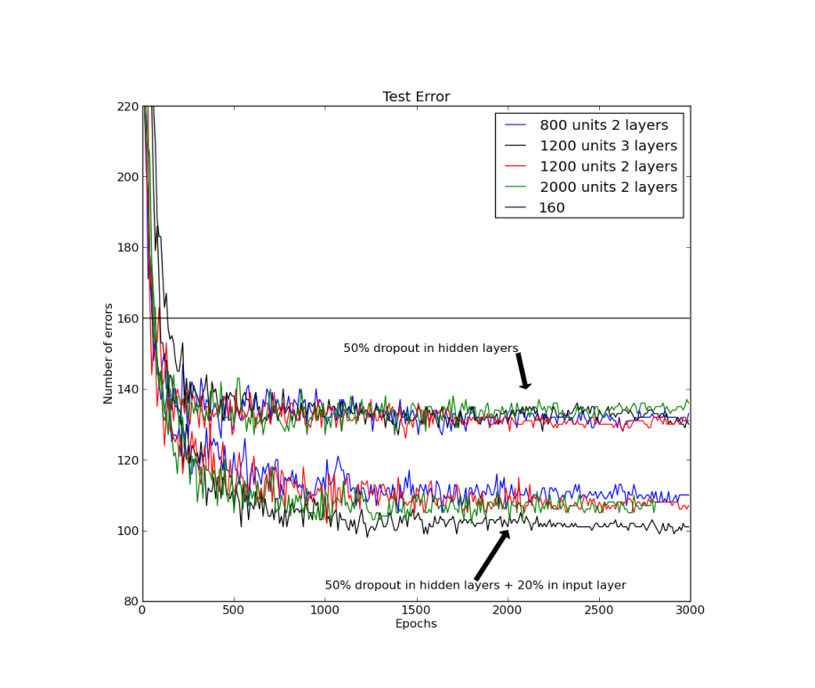
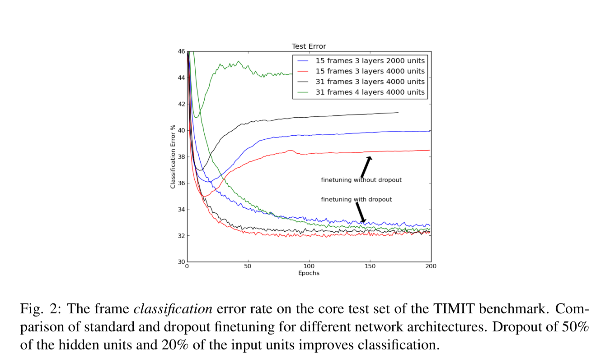
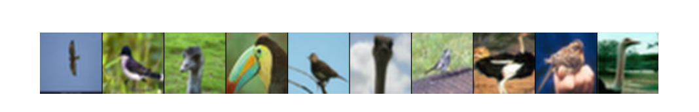
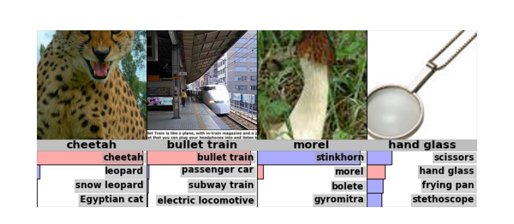

# Front matter

> Section 1 of 14 from [21 - Dropout: A Simple Way to Prevent Neural Networks from Overfitting](../../papers/21-dropout-regularization.md) · `front-matter` · pages 1-6

The text below was extracted programmatically from the published PDF, page by page, with figures kept inline where they appear. `<!-- page N -->` comments mark the original page boundaries. Mathematical notation is preserved as plain text rather than LaTeX, so equations read approximately rather than exactly.[^original]

## Improving neural networks by preventing

## co-adaptation of feature detectors

## G. E. Hinton∗, N. Srivastava, A. Krizhevsky, I. Sutskever and R. R. Salakhutdinov

Department of Computer Science, University of Toronto,

6 King’s College Rd, Toronto, Ontario M5S 3G4, Canada

∗To whom correspondence should be addressed; E-mail: hinton@cs.toronto.edu

When a large feedforward neural network is trained on a small training set, it typically performs poorly on held-out test data. This “overfitting” is greatly reduced by randomly omitting half of the feature detectors on each training case. This prevents complex co-adaptations in which a feature detector is only helpful in the context of several other specific feature detectors. Instead, each neuron learns to detect a feature that is generally helpful for producing the correct answer given the combinatorially large variety of internal contexts in which it must operate. Random “dropout” gives big improvements on many benchmark tasks and sets new records for speech and object recognition.

A feedforward, artificial neural network uses layers of non-linear “hidden” units between its inputs and its outputs. By adapting the weights on the incoming connections of these hidden units it learns feature detectors that enable it to predict the correct output when given an input vector (1). If the relationship between the input and the correct output is complicated and the network has enough hidden units to model it accurately, there will typically be many different settings of the weights that can model the training set almost perfectly, especially if there is only a limited amount of labeled training data. Each of these weight vectors will make different predictions on held-out test data and almost all of them will do worse on the test data than on the training data because the feature detectors have been tuned to work well together on the training data but not on the test data.

Overfitting can be reduced by using “dropout” to prevent complex co-adaptations on the training data. On each presentation of each training case, each hidden unit is randomly omitted from the network with a probability of 0.5, so a hidden unit cannot rely on other hidden units being present. Another way to view the dropout procedure is as a very efficient way of performing model averaging with neural networks. A good way to reduce the error on the test set is to average the predictions produced by a very large number of different networks. The standard

1

way to do this is to train many separate networks and then to apply each of these networks to the test data, but this is computationally expensive during both training and testing. Random dropout makes it possible to train a huge number of different networks in a reasonable time. There is almost certainly a different network for each presentation of each training case but all of these networks share the same weights for the hidden units that are present.

We use the standard, stochastic gradient descent procedure for training the dropout neural networks on mini-batches of training cases, but we modify the penalty term that is normally used to prevent the weights from growing too large. Instead of penalizing the squared length (L2 norm) of the whole weight vector, we set an upper bound on the L2 norm of the incoming weight vector for each individual hidden unit. If a weight-update violates this constraint, we renormalize the weights of the hidden unit by division. Using a constraint rather than a penalty prevents weights from growing very large no matter how large the proposed weight-update is. This makes it possible to start with a very large learning rate which decays during learning, thus allowing a far more thorough search of the weight-space than methods that start with small weights and use a small learning rate.

At test time, we use the “mean network” that contains all of the hidden units but with their outgoing weights halved to compensate for the fact that twice as many of them are active. In practice, this gives very similar performance to averaging over a large number of dropout networks. In networks with a single hidden layer of N units and a “softmax” output layer for computing the probabilities of the class labels, using the mean network is exactly equivalent to taking the geometric mean of the probability distributions over labels predicted by all 2N

possible networks. Assuming the dropout networks do not all make identical predictions, the prediction of the mean network is guaranteed to assign a higher log probability to the correct answer than the mean of the log probabilities assigned by the individual dropout networks (2). Similarly, for regression with linear output units, the squared error of the mean network is always better than the average of the squared errors of the dropout networks.

We initially explored the effectiveness of dropout using MNIST, a widely used benchmark for machine learning algorithms. It contains 60,000 28x28 training images of individual hand written digits and 10,000 test images. Performance on the test set can be greatly improved by enhancing the training data with transformed images (3) or by wiring knowledge about spatial transformations into a convolutional neural network (4) or by using generative pre-training to extract useful features from the training images without using the labels (5). Without using any of these tricks, the best published result for a standard feedforward neural network is 160 errors on the test set. This can be reduced to about 130 errors by using 50% dropout with separate L2 constraints on the incoming weights of each hidden unit and further reduced to about 110 errors by also dropping out a random 20% of the pixels (see figure 1).

Dropout can also be combined with generative pre-training, but in this case we use a small learning rate and no weight constraints to avoid losing the feature detectors discovered by the pre-training. The publically available, pre-trained deep belief net described in (5) got 118 errors when it was fine-tuned using standard back-propagation and 92 errors when fine-tuned using 50% dropout of the hidden units. When the publically available code at URL was used to pre-

2

Fig. 1: The error rate on the MNIST test set for a variety of neural network architectures trained with backpropagation using 50% dropout for all hidden layers. The lower set of lines also use 20% dropout for the input layer. The best previously published result for this task using backpropagation without pre-training or weight-sharing or enhancements of the training set is shown as a horizontal line.

train a deep Boltzmann machine five times, the unrolled network got 103, 97, 94, 93 and 88 errors when fine-tuned using standard backpropagation and 83, 79, 78, 78 and 77 errors when using 50% dropout of the hidden units. The mean of 79 errors is a record for methods that do not use prior knowledge or enhanced training sets (For details see Appendix A).

We then applied dropout to TIMIT, a widely used benchmark for recognition of clean speech with a small vocabulary. Speech recognition systems use hidden Markov models (HMMs) to deal with temporal variability and they need an acoustic model that determines how well a frame of coefficients extracted from the acoustic input fits each possible state of each hidden Markov model. Recently, deep, pre-trained, feedforward neural networks that map a short sequence of frames into a probability distribution over HMM states have been shown to outperform tradional Gaussian mixture models on both TIMIT (6) and a variety of more realistic large vocabulary tasks (7,8).

Figure 2 shows the frame classification error rate on the core test set of the TIMIT benchmark when the central frame of a window is classified as belonging to the HMM state that is given the highest probability by the neural net. The input to the net is 21 adjacent frames with an advance of 10ms per frame. The neural net has 4 fully-connected hidden layers of 4000 units per

3

Fig. 2: The frame classification error rate on the core test set of the TIMIT benchmark. Comparison of standard and dropout finetuning for different network architectures. Dropout of 50% of the hidden units and 20% of the input units improves classification.

layer and 185 “softmax” output units that are subsequently merged into the 39 distinct classes used for the benchmark. Dropout of 50% of the hidden units significantly improves classification for a variety of different network architectures (see figure 2). To get the frame recognition rate, the class probabilities that the neural network outputs for each frame are given to a decoder which knows about transition probabilities between HMM states and runs the Viterbi algorithm to infer the single best sequence of HMM states. Without dropout, the recognition rate is 22.7% and with dropout this improves to 19.7%, which is a record for methods that do not use any information about speaker identity.

CIFAR-10 is a benchmark task for object recognition. It uses 32x32 downsampled color images of 10 different object classes that were found by searching the web for the names of the class (e.g. dog) or its subclasses (e.g. Golden Retriever). These images were labeled by hand to produce 50,000 training images and 10,000 test images in which there is a single dominant object that could plausibly be given the class name (9) (see figure 3). The best published error rate on the test set, without using transformed data, is 18.5% (10). We achieved an error rate of 16.6% by using a neural network with three convolutional hidden layers interleaved with three “max-pooling” layers that report the maximum activity in local pools of convolutional units. These six layers were followed by one locally-connected layer (For details see Appendix D) . Using dropout in the last hidden layer gives an error rate of 15.6%.

ImageNet is an extremely challenging object recognition dataset consisting of thousands of high-resolution images of thousands of classes of object (11). In 2010, a subset of 1000 classes with roughly 1000 examples per class was the basis of an object recognition competition in

4

Fig. 3: Ten examples of the class “bird” from the CIFAR-10 test set illustrating the variety of types of bird, viewpoint, lighting and background. The neural net gets all but the last two examples correct.

which the winning entry, which was actually an average of six separate models, achieved an error rate of 47.2% on the test set. The current state-of-the-art result on this dataset is 45.7% (12). We achieved comparable performance of 48.6% error using a single neural network with five convolutional hidden layers interleaved with “max-pooling” layer followed by two globally connected layers and a final 1000-way softmax layer. All layers had L2 weight constraints on the incoming weights of each hidden unit. Using 50% dropout in the sixth hidden layer reduces this to a record 42.4% (For details see Appendix E).

For the speech recognition dataset and both of the object recognition datasets it is necessary to make a large number of decisions in designing the architecture of the net. We made these decisions by holding out a separate validation set that was used to evaluate the performance of a large number of different architectures and we then used the architecture that performed best with dropout on the validation set to assess the performance of dropout on the real test set.

The Reuters dataset contains documents that have been labeled with a hierarchy of classes. We created training and test sets each containing 201,369 documents from 50 mutually exclusive classes. Each document was represented by a vector of counts for 2000 common non-stop words, with each count C being transformed to log(1+C). A feedforward neural network with 2 fully connected layers of 2000 hidden units trained with backpropagation gets 31.05% error on the test set. This is reduced to 29.62% by using 50% dropout (Appendix C).

We have tried various dropout probabilities and almost all of them improve the generalization performance of the network. For fully connected layers, dropout in all hidden layers works better than dropout in only one hidden layer and more extreme probabilities tend to be worse, which is why we have used 0.5 throughout this paper. For the inputs, dropout can also help,

Fig. 4: Some Imagenet test cases with the probabilities of the best 5 labels underneath. Many of the top 5 labels are quite plausible.

5

though it it often better to retain more than 50% of the inputs. It is also possible to adapt the individual dropout probability of each hidden or input unit by comparing the average performance on a validation set with the average performance when the unit is present. This makes the method work slightly better. For datasets in which the required input-output mapping has a number of fairly different regimes, performance can probably be further improved by making the dropout probabilities be a learned function of the input, thus creating a statistically efficient “mixture of experts” (13) in which there are combinatorially many experts, but each parameter gets adapted on a large fraction of the training data.

Dropout is considerably simpler to implement than Bayesian model averaging which weights each model by its posterior probability given the training data. For complicated model classes, like feedforward neural networks, Bayesian methods typically use a Markov chain Monte Carlo method to sample models from the posterior distribution (14). By contrast, dropout with a probability of 0.5 assumes that all the models will eventually be given equal importance in the combination but the learning of the shared weights takes this into account. At test time, the fact that the dropout decisions are independent for each unit makes it very easy to approximate the combined opinions of exponentially many dropout nets by using a single pass through the mean net. This is far more efficient than averaging the predictions of many separate models.

A popular alternative to Bayesian model averaging is “bagging” in which different models are trained on different random selections of cases from the training set and all models are given equal weight in the combination (15). Bagging is most often used with models such as decision trees because these are very quick to fit to data and very quick at test time (16). Dropout allows a similar approach to be applied to feedforward neural networks which are much more powerful models. Dropout can be seen as an extreme form of bagging in which each model is trained on a single case and each parameter of the model is very strongly regularized by sharing it with the corresponding parameter in all the other models. This is a much better regularizer than the standard method of shrinking parameters towards zero.

A familiar and extreme case of dropout is “naive bayes” in which each input feature is trained separately to predict the class label and then the predictive distributions of all the features are multiplied together at test time. When there is very little training data, this often works much better than logistic classification which trains each input feature to work well in the context of all the other features.

Finally, there is an intriguing similarity between dropout and a recent theory of the role of sex in evolution (17). One possible interpretation of the theory of mixability articulated in (17) is that sex breaks up sets of co-adapted genes and this means that achieving a function by using a large set of co-adapted genes is not nearly as robust as achieving the same function, perhaps less than optimally, in multiple alternative ways, each of which only uses a small number of co-adapted genes. This allows evolution to avoid dead-ends in which improvements in fitness require co- ordinated changes to a large number of co-adapted genes. It also reduces the probability that small changes in the environment will cause large decreases in fitness a phenomenon which is known as “overfitting” in the field of machine learning.

6

---

Full document: [21 - Dropout: A Simple Way to Prevent Neural Networks from Overfitting](../../papers/21-dropout-regularization.md) · Page-level evidence: [paper-pages/21-dropout-regularization](../../paper-pages/21-dropout-regularization/index.md)
