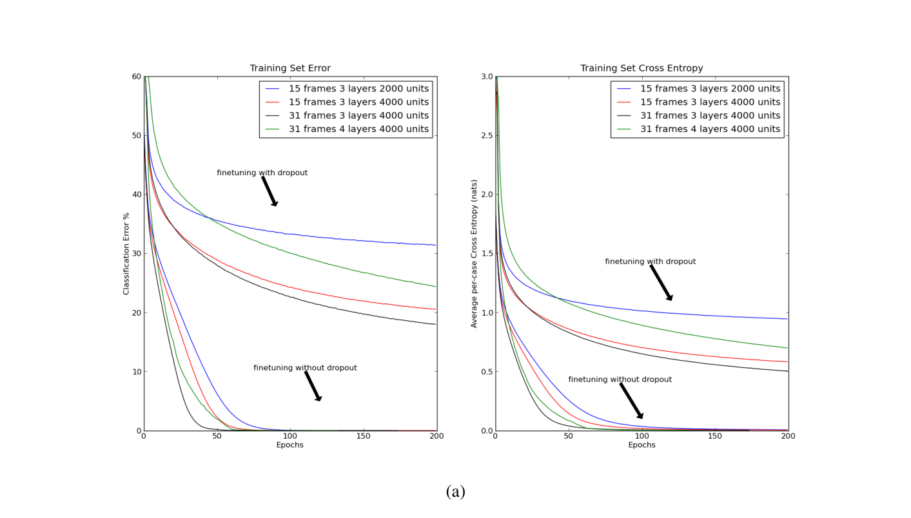
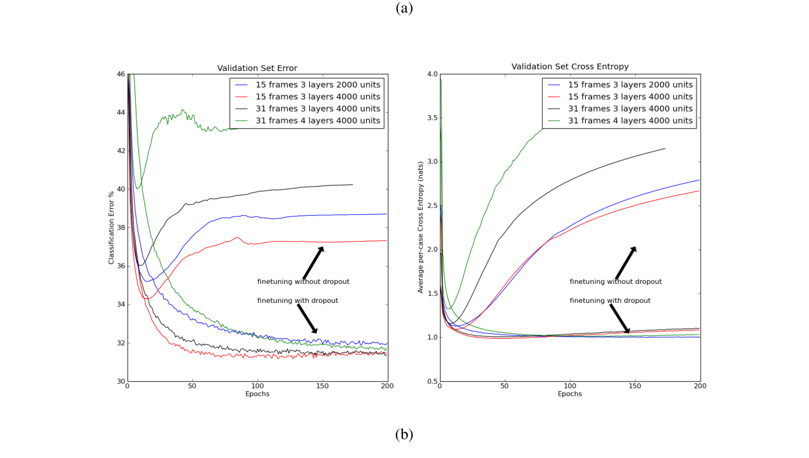

# B.1 Pretraining

> Section 5 of 14 from [21 - Dropout: A Simple Way to Prevent Neural Networks from Overfitting](../../papers/21-dropout-regularization.md) · `other` · pages 9-11

For all our experiments on TIMIT, we pretrain the neural network with a Deep Belief Network (5). Since the inputs are real-valued, the first layer was pre-trained as a Gaussian RBM.

3http://kaldi.sourceforge.net

10

(a)

(b)

Fig. 6: Frame classification error and cross-entropy on the (a) Training and (b) Validation set as learning progresses. The training error is computed using the stochastic nets.

11

Visible biases were initialized to zero and weights to random numbers sampled from a zeromean normal distribution with standard deviation 0.01. The variance of each visible unit was set to 1.0 and not learned. Learning was done by minimizing Contrastive Divergence. Momentum was used to speed up learning. Momentum started at 0.5 and was increased linearly to 0.9 over 20 epochs. A learning rate of 0.001 on the average gradient was used (which was then multiplied by 1-momentum). An L2 weight decay of 0.001 was used. The model was trained for 100 epochs.

All subsequent layers were trained as binary RBMs. A learning rate of 0.01 was used. The visible bias of each unit was initialized to log(p/(1 −p)) where p was the mean activation of that unit in the dataset. All other hyper-parameters were set to be the same as those we used for the Gaussian RBM. Each layer was trained for 50 epochs.

---

Full document: [21 - Dropout: A Simple Way to Prevent Neural Networks from Overfitting](../../papers/21-dropout-regularization.md) · Page-level evidence: [paper-pages/21-dropout-regularization](../../paper-pages/21-dropout-regularization/index.md)
