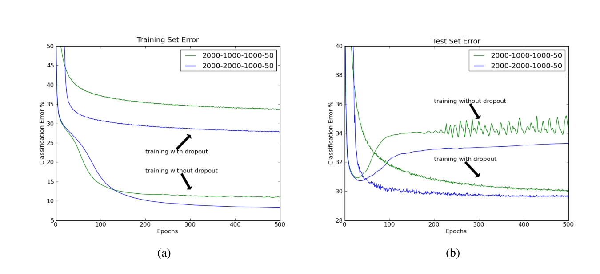
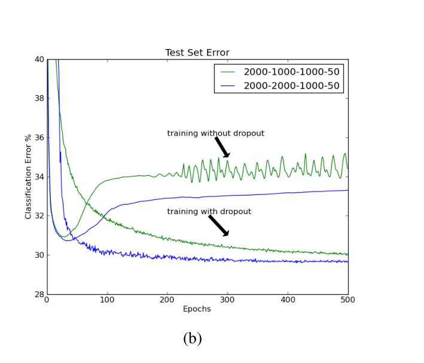

# C Experiments on Reuters

> Section 7 of 14 from [21 - Dropout: A Simple Way to Prevent Neural Networks from Overfitting](../../papers/21-dropout-regularization.md) · `other` · pages 11-12

Reuters Corpus Volume I (RCV1-v2) (19) is an archive of 804,414 newswire stories that have been manually categorized into 103 topics4. The corpus covers four major groups: corporate/industrial, economics, government/social, and markets. Sample topics include Energy Markets, Accounts/Earnings, Government Borrowings, Disasters and Accidents, Interbank Markets, Legal/Judicial, Production/Services, etc. The topic classes form a tree which is typically of depth three.

We took the dataset and split it into 63 classes based on the the 63 categories at the secondlevel of the category tree. We removed 11 categories that did not have any data and one category

4The corpus is available at http://www.ai.mit.edu/projects/jmlr/papers/volume5/lewis04a/lyrl2004 rcv1v2 README.htm

12

that had only 4 training examples. We also removed one category that covered a huge chunk (25%) of the examples. This left us with 50 classes and 402,738 documents. We divided the documents into equal-sized training and test sets randomly. Each document was represented using the 2000 most frequent non-stopwords in the dataset.

(a)

(b)

Fig. 7: Classification error rate on the (a) training and (b) validation sets of the Reuters dataset as learning progresses. The training error is computed using the stochastic nets.

We trained a neural network using dropout-backpropagation and compared it with standard backpropagation. We used a 2000-2000-1000-50 architecture. The training hyperparameters are same as that in MNIST dropout training (Appendix A.1). Training was done for 500 epochs.

Figure 7 shows the training and test set errors as learning progresses. We show two nets - one with a 2000-2000-1000-50 and another with a 2000-1000-1000-50 architecture trained with and without dropout. As in all previous datasets discussed so far, we obtain significant improvements here too. The learning not only results in better generalization, but also proceeds smoothly, without the need for early stopping.

---

Full document: [21 - Dropout: A Simple Way to Prevent Neural Networks from Overfitting](../../papers/21-dropout-regularization.md) · Page-level evidence: [paper-pages/21-dropout-regularization](../../paper-pages/21-dropout-regularization/index.md)
