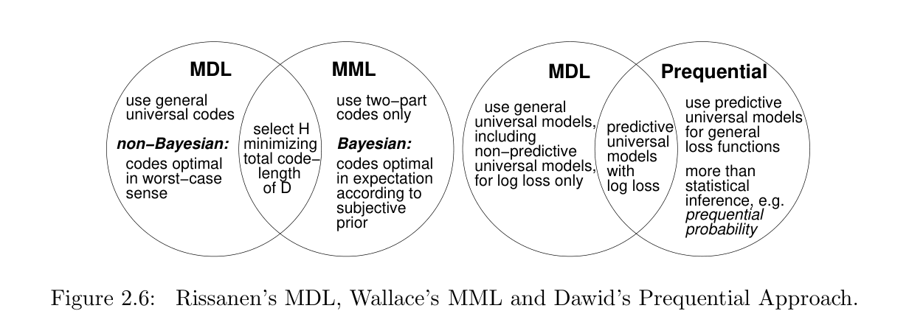

# 2.9 Relations to Other Approaches to Inductive Inference

> Section 18 of 23 from [24 - A Tutorial Introduction to the Minimum Description Length Principle](../../papers/24-tutorial-minimum-description-length.md) · `other` · pages 63-66

How does MDL compare to other model selection and statistical inference methods? In order to answer this question, we first have to be precise about what we mean by ‘MDL’; this is done in Section 2.9.1. We then continue in Section 2.9.2 by summarizing MDL’s relation to Bayesian inference, Wallace’s MML Principle, Dawid’s prequential model validation, cross-validation and an ‘idealized’ version of MDL based on Kolmogorov complexity. The literature has also established connections between MDL and Jaynes’ \[2003\] Maximum Entropy Principle \[Feder 1986; Li and Vit´anyi 1997; Gr¨unwald 1998; Gr¨unwald 2000; Gr¨unwald and Dawid 2004\] and Vapnik’s \[1998\] structural risk minimization principle \[Gr¨unwald 1998\], but there is no space here to discuss these. Relations between MDL and Akaike’s AIC \[Burnham and Anderson 2002\] are subtle. They are discussed by, for example, Speed and Yu \[1993\].

2.9.1 What is ‘MDL’?

‘MDL’ is used by different authors in somewhat different meanings. Some authors use MDL as a broad umbrella term for all types of inductive inference based on data compression. This would, for example, include the ‘idealized’ versions of MDL based on Kolmogorov complexity and Wallaces’s MML Principle, to be discussed below. On the other extreme, for historical reasons, some authors use the MDL Criterion to describe a very specific (and often not very successful) model selection criterion equivalent to BIC, discussed further below.

Here we adopt the meaning of the term that is embraced in the survey \[Barron, Rissanen, and Yu 1998\], written by arguably the three most important contributors to the field: we use MDL for general inference based on universal models. These include, but are not limited to approaches in the spirit of Figure 2.4. For example, some authors have based their inferences on ‘expected’ rather than ‘individual sequence’ universal models \[Barron, Rissanen, and Yu 1998; Liang and Barron 2004a\]. Moreover, if we go beyond model selection (Section 2.8), then the ideas of Figure 2.4 have to be modified to some extent. In fact, one of the main strengths of “MDL” in this broad sense is that it can be applied to ever more exotic modeling situations, in which the models do not resemble anything that is usually encountered in statistical practice. An example is the model of context-free grammars, already suggested by Solomonoff \[1964\]. In this tutorial, we call applications of MDL that strictly fit into the scheme of Figure 2.4 refined MDL for model/hypothesis selection; when we simply say ‘MDL’, we mean ‘inductive inference based on universal models’. This form of inductive inference goes hand in hand with Rissanen’s radical MDL philosophy, which views learning as finding useful properties of the data, not necessarily related to the existence of a ‘truth’ underlying the data. This view was outlined in Chapter 1, Section 1.5. Although MDL practitioners and theorists are usually sympathetic to it, the different interpretations of MDL listed in Section 2.6 make clear that MDL applications can also be justified without adopting such a radical philosophy.

64

2.9.2 MDL and Bayesian Inference

Bayesian statistics \[Lee 1997; Bernardo and Smith 1994\] is one of the most well-known, frequently and successfully applied paradigms of statistical inference. It is often claimed that ‘MDL is really just a special case of Bayes19’. Although there are close similarities, this is simply not true. To see this quickly, consider the basic quantity in refined MDL: the NML distribution ¯Pnml, Equation (2.18). While ¯Pnml – although defined in a completely different manner – turns out to be closely related to the Bayesian marginal likelihood, this is no longer the case for its ‘localized’ version (2.37). There is no mention of anything like this code/distribution in any Bayesian textbook! Thus, it must be the case that Bayes and MDL are somehow different.

MDL as a Maximum Probability Principle For a more detailed analysis, we need to distinguish between the two central tenets of modern Bayesian statistics: (1) Probability distributions are used to represent uncertainty, and to serve as a basis for making predictions; rather than standing for some imagined ‘true state of nature’. (2) All inference and decision-making is done in terms of prior and posterior distributions. MDL sticks with (1) (although here the ‘distributions’ are primarily interpreted as ‘codelength functions’), but not (2): MDL allows the use of arbitrary universal models such as NML and prequential universal models; the Bayesian universal model does not have a special status among these. In this sense, Bayes offers the statistician less freedom in choice of implementation than MDL. In fact, MDL may be reinterpreted as a maximum probability principle, where the maximum is relative to some given model, in the worst-case over all sequences (Rissanen \[1987, 1989\] uses the phrase ‘global maximum likelihood principle’). Thus, whenever the Bayesian universal model is used in an MDL application, a prior should be used that minimizes worst-case codelength regret, or equivalently, maximizes worst-case relative probability. There is no comparable principle for choosing priors in Bayesian statistics, and in this respect, Bayes offers a lot more freedom than MDL.

Example 2.22 There is a conceptual problem with Bayes’ use of prior distributions: in practice, we very often want to use models which we a priori know to be wrong – see Example 1.5. If we use Bayes for such models, then we are forced to put a prior distribution on a set of distributions which we know to be wrong - that is, we have degree-of-belief 1 in something we know not to be the case. From an MDL viewpoint, these priors are interpreted as tools to achieve short codelengths rather than degrees-of-belief and there is nothing strange about the situation; but from a Bayesian viewpoint, it seems awkward. To be sure, Bayesian inference often gives good results even if the model M is known to be wrong; the point is that (a) if one is a strict Bayesian, one would never apply Bayesian inference to such misspecified M, and (b), the Bayesian theory offers no clear explanation of why Bayesian inference might still give good results for such M. MDL provides both codelength and predictive-sequential interpretations of Bayesian inference, which help explain why Bayesian inference may do something reasonable even if M is misspecified. To be fair, we should add that there exists variations of the Bayesian

65

philosophy (e.g. De Finetti \[1974\]’s) which avoid the conceptual problem we just described.

MDL and BIC In the first paper on MDL, Rissanen \[1978\] used a two-part code and showed that, asymptotically, and under regularity conditions, the two-part codelength of xn based on a k-parameter model M with an optimally discretized parameter space is given by

−log P(xn | ˆθ(xn)) + k

2 log n, (2.42)

thus ignoring O(1)-terms, which, as we have already seen, can be quite important. In the same year Schwarz \[1978\] showed that, for large enough n, Bayesian model selection between two exponential families amounts to selecting the model minimizing (2.42), ignoring O(1)-terms as well. As a result of Schwarz’s paper, model selection based on (2.42) became known as the BIC (Bayesian Information Criterion). Not taking into account the functional form of the model M, it often does not work very well in practice.

It has sometimes been claimed that MDL = BIC; for example, \[Burnham and Anderson 2002, page 286\] write “Rissanen’s result is equivalent to BIC”. This is wrong, even for the 1989 version of MDL that Burnham and Anderson refer to – as pointed out by Foster and Stine \[2004\], the BIC approximation only holds if the number of parameters k is kept fixed and n goes to infinity. If we select between nested families of models where the maximum number of parameters k considered is either infinite or grows with n, then model selection based on both ¯Pnml and on ¯PBayes tends to select quite different models than BIC - if k gets closer to n, the contribution to COMPn(M) of each additional parameter becomes much smaller than 0.5 log n \[Foster and Stine 2004\]. However, researchers who claim MDL = BIC have a good excuse: in early work, Rissanen himself has used the phrase ‘MDL criterion’ to refer to (2.42), and unfortunately, the phrase has stuck.

MDL and MML MDL shares some ideas with the Minimum Message Length (MML) Principle which predates MDL by 10 years. Key references are \[Wallace and Boulton 1968; Wallace and Boulton 1975\] and \[Wallace and Freeman 1987\]; a long list is in \[Comley and Dowe 2004\]. Just as in MDL, MML chooses the hypothesis minimizing the code-length of the data. But the codes that are used are quite different from those in MDL. First of all, in MML one always uses two-part codes, so that MML automatically selects both a model family and parameter values. Second, while the MDL codes such as

¯Pnml minimize worst-case relative code-length (regret), the two-part codes used by MML are designed to minimize expected absolute code-length. Here the expectation is taken over a subjective prior distribution defined on the collection of models and parameters under consideration. While this approach contradicts Rissanen’s philosophy, in practice it often leads to similar results.

66

---

Full document: [24 - A Tutorial Introduction to the Minimum Description Length Principle](../../papers/24-tutorial-minimum-description-length.md) · Page-level evidence: [paper-pages/24-tutorial-minimum-description-length](../../paper-pages/24-tutorial-minimum-description-length/index.md)
