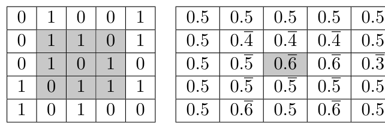

# 4 Approximating Apparent Complexity

> Section 13 of 21 from [25 - Quantifying the Rise and Fall of Complexity in Closed Systems: The Coffee Automaton](../../papers/25-coffee-automaton.md) · `other` · pages 9-11

While Kolmogorov complexity and sophistication are useful theoretical notions to model our ideas of entropy and complexity, they cannot be directly applied in numerical simulations, because they are both uncomputable. As such, while we use these concepts as a theoretical foundation, we need to develop algorithms that attempt to approximate them.

Evans et al. \[5\] propose an algorithm, called the optimal symbol compression ratio (OSCR) algorithm, which directly estimates Kolmogorov complexity and sophistication. Given an input

4At www.scottaaronson.com/coffee automaton.zip

10

string x, the OSCR algorithm produces a two-part code. The first part is a codebook, which maps symbols chosen from the original input string to new symbols in the encoded string. The second part of the code is the input string, encoded using the symbols in this codebook. The goal of OSCR is to select which symbols to put in the codebook such that the total size of the output—codebook size plus encoded string size—is minimized. The optimal codebook size for x is an estimate of K (S), the sophistication of x. The optimal total size of the output for x is called the minimum description length (MDL) of the string, and is an estimate of K (x).

The OSCR approach seems promising because of its direct relationship to the functions we are interested in approximating. However, we implemented a version of this algorithm, and we found that our implementation does not perform well in compressing the automaton data. The output of the algorithm is noisy, and there is no obvious trend in either the entropy or complexity estimates. We conjecture that the noise is present because this compression method, unlike others we consider, does not take into account the two-dimensionality of the automaton state.

An alternative metric adopts the idea of coarse-graining. Here we aim to describe a system’s state on a macroscopic scale—for example, the coffee cup as it would be seen by a human observer from a few feet away—by smoothing the state, averaging nearby values together. Conceptually, for an automaton state represented by a string x, its coarse-grained version is analogous to a typical set S which contains x. The coarse-grained state describes the high-level, “non-random” features of x—features which it has in common with all other states from which the same coarse-grained representation could be derived. Thus, the descriptive size of the coarse-grained state can be used as an estimate for the state’s sophistication, K (S). To estimate the descriptive size of the coarse-grained state, we compress it using a general file compression program, such as gzip or bzip. Shalizi \[11\] objects to the use of such compression programs, claiming that they do not provide consistently accurate entropy estimates and that they are too slow. In our experiments, we have not seen either of these problems; our simulations run in a reasonable amount of time and produce quite consistent entropy estimates (see, for instance, Figure 5). We therefore use such compression programs throughout, though we consider alternative approaches in Section 7.

Having defined the notion of coarse-graining, we can then define a two-part code based on it. If the first part of the code—the typical set—is the coarse-grained state, then the second part is K (x|S), the information needed to reconstruct the fine-grained state given the coarse-grained version. The total compressed size of both parts of the code is an estimate of the Kolmogorov complexity of the state, K (x).

We attempted to implement such a two-part code, in which the second part was a diffbetween the fine-grained and coarse-grained states. The fine-grained state, x, could be uniquely reconstructed from the coarse-grained array and the diff. In our implementation of this two-part code, our estimate of K (x|S) suffered from artifacts due to the way the diffwas represented. However, defining a two-part code based on coarse-graining is possible in general.

In light of the artifacts produced by our implementation of the two-part code, we chose to pursue a more direct approach using coarse-graining. We continued to use the compressed size of the coarse-grained state as an approximation of K (S). However, instead of approximating K (x|S) and using K (S) + K (x|S) as an estimate of K (x), we approximated K (x) directly, by measuring the compressed size of the fine-grained array. This approach avoided the artifacts of the diff-based code, and was used to generate the results reported here.

11

Fine-Grained Coarse-Grained 0 1 0 0 1 0 1 1 0 1 0 1 0 1 0 1 0 1 1 1 1 0 1 0 0

0.5 0.5 0.5 0.5 0.5 0.5 0.4 0.4 0.4 0.5 0.5 0.5 0.6 0.6 0.3 0.5 0.5 0.5 0.5 0.5 0.5 0.6 0.5 0.6 0.5

Figure 1: Illustration of the construction of the coarse-grained array, using an example grain size of 3. The values of the shaded cells at left are averaged to produce the value of the shaded cell at right.

---

Full document: [25 - Quantifying the Rise and Fall of Complexity in Closed Systems: The Coffee Automaton](../../papers/25-coffee-automaton.md) · Page-level evidence: [paper-pages/25-coffee-automaton](../../paper-pages/25-coffee-automaton/index.md)
