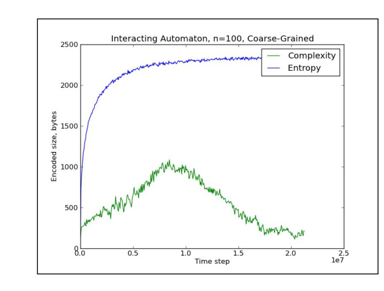
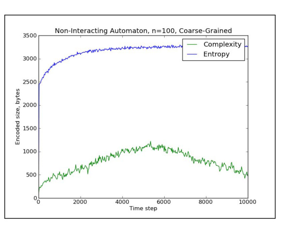

# 5.2 Results and Analysis

> Section 15 of 21 from [25 - Quantifying the Rise and Fall of Complexity in Closed Systems: The Coffee Automaton](../../papers/25-coffee-automaton.md) · `results` · pages 11-13

Results from simulation of the automaton using the coarse-graining metric are shown in Figure 2.

Figure 2: The estimated entropy and complexity of an automaton using the coarse-graining metric. Results for the interacting model are shown at left, and results for the non-interacting model are at right.

12

Both the interacting and non-interacting models show the predicted increasing, then decreasing pattern of complexity. Both models also have an increasing entropy pattern, which is expected due to the second law of thermodynamics. The initial spike in entropy for the non-interacting automaton can be explained by the fact that all of the particles can move simultaneously after the first time step. Thus, the number of bits needed to represent the state of the non-interacting automaton jumps after the first time step. With the interacting automaton, by contrast, particles far from the coffee-cream border cannot move until particles closer to the border have moved, so there is less change in the automaton at each time step. Therefore, the estimated entropy of this model is predictably more continuous throughout.

A visualization of the automaton’s changing state over time is provided in Figures 3 and 4. This visualization is generated by converting each cell’s value to a grayscale color value; lighter colors correspond to larger values. Visually, the fine-grained representation of the state continues to grow more complicated with time, while the coarse-grained representation first becomes first more and then less complicated.

t = 0 t = 8 × 106 t = 2 × 107

Figure 3: Visualization of the state of the interacting automaton of size 100 over time. The top row of images is the fine-grained array, used to estimate entropy. The bottom row is the coarse-grained array, used to estimate complexity. From left to right, the images represent the automaton state at the beginning of the simulation, at the complexity maximum, and at the end of the simulation.

The gzip compression algorithm was used to generate the results in Figure 2, and is used throughout when a general file compression program is needed. The results achieved using the coarse-graining metric are qualitatively similar when different compression programs are used, as shown in Figure 5.

Given these results, it is informative to examine how complexity varies with n, the size of the automaton.

The well-fit quadratic curve for the maximum values of entropy (Figure 6) is expected. The maximum entropy of an automaton is proportional to the number of particles in the automaton. This is because, if the state of the automaton is completely random, then the compressed size of the state is equal to the uncompressed size–the number of particles. As the automaton size, n, increases, the number of particles increases to n2.

13

t = 0 t = 5000 t = 10000

Figure 4: Visualization of the state of the non-interacting automaton of size 100 over time.

The maximum values of complexity appear to increase linearly as the automaton size increases (Figure 7). That is, maximum complexity is proportional to the side length of the two-dimensional state array. This result is expected, since the automaton begins in a state which is symmetric along its vertical axis, and complexity presumably develops along a single dimension of the automaton. The time that it takes for the automaton to reach its complexity maximum appears to increase quadratically with the automaton size, or proportionally to the number of particles in the automaton (Figure 8). This result is also expected, since the time for n2 particles to reach a particular configuration is proportional to n2.

---

Full document: [25 - Quantifying the Rise and Fall of Complexity in Closed Systems: The Coffee Automaton](../../papers/25-coffee-automaton.md) · Page-level evidence: [paper-pages/25-coffee-automaton](../../paper-pages/25-coffee-automaton/index.md)
