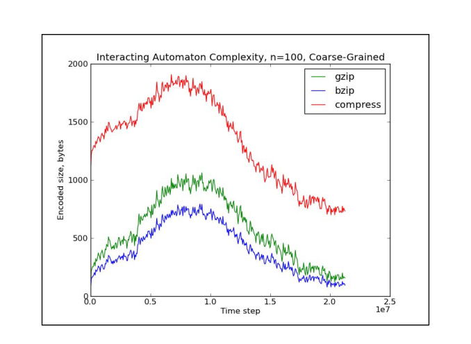
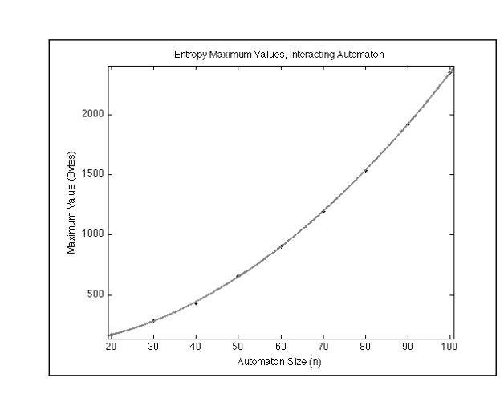
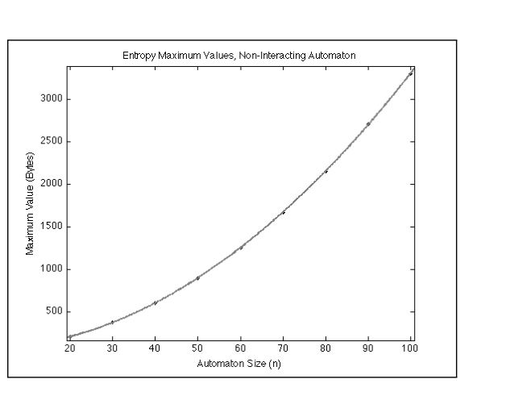
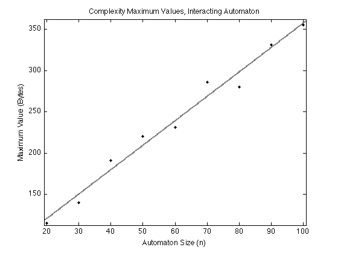
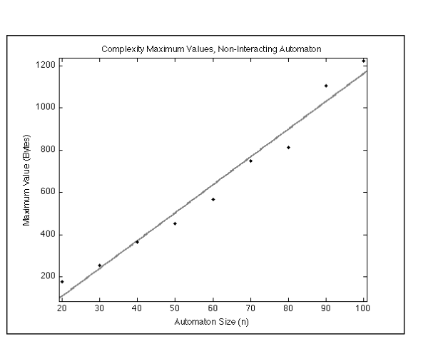
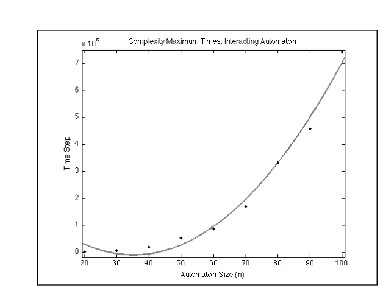
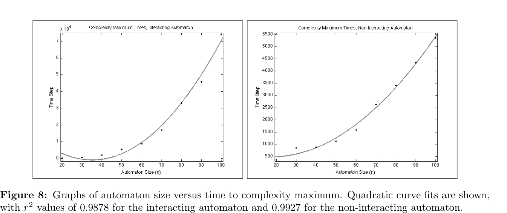
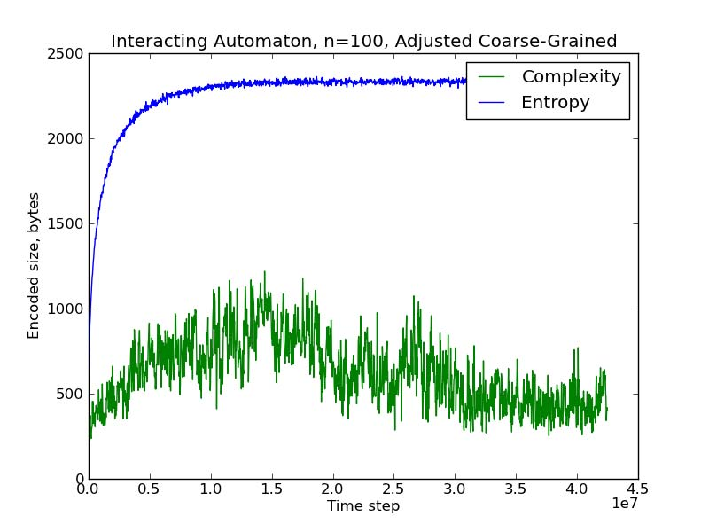
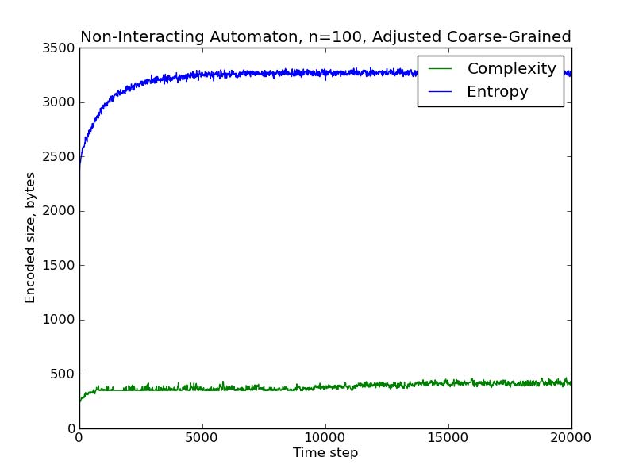

# 6.1 Method

> Section 16 of 21 from [25 - Quantifying the Rise and Fall of Complexity in Closed Systems: The Coffee Automaton](../../papers/25-coffee-automaton.md) · `method` · pages 13-16

Though the original coarse-graining approach produces the hypothesized complexity pattern, the method of thresholding used in the previous experiment—dividing the floating-point values into three buckets—has the potential to introduce artificial complexity. Consider, for example, an automaton state for which the coarse-grained array is a smooth gradient from 0 to 1. By definition, there will be some row of the array which lies on the border between two threshold values. Tiny fluctuations in the values of the coarse-grained array may cause the cells in this row to fluctuate between two threshold values. In such a case, the small fluctuations in this border row would artificially increase the measured complexity of the coarse-grained array. This case is illustrated in Figure 9.

We propose an adjustment to the coarse-graining algorithm that helps to minimize these artifacts. First, we use a larger number of thresholds—seven, in contrast to the three used in the original experiment. Additionally, we allow each cell in the array to be optionally, independently adjusted up or down by one threshold, in whatever manner achieves the smallest possible file size for the coarse-grained array.

This adjustment helps to compensate for the thresholding artifacts–such random fluctuations

14

Figure 5: Coarse-grained complexity estimates for a single simulation of the interacting automaton, using multiple file compression programs.

Figure 6: Graphs of automaton size versus entropy maximum value. Quadratic curve fits are shown, with r2 values of 0.9999 for both the interacting and non-interacting automaton.

could be removed by adjusting the fluctuating pixels. However, since each pixel can be adjusted independently, there are 2n2 possible ways to adjust a given coarse-grained array.

Because we cannot search through this exponential number of possible adjustments to find the optimal one, we develop an approximation algorithm to produce an adjustment that specifically targets pixels on the border between two thresholds. Given the properties of the automaton—it begins with rows of dark cells on top, and light cells on the bottom—it is likely that each row of the coarse-grained array will contain similar values. Thus, we adjust the coarse-grained array by using a majority algorithm. If a cell is within one threshold value of the majority value in its row, it is adjusted to the majority value.

The hope is that

(1) this adjustment will reduce artificial border complexity by “flattening” fluctuating border

rows to a single color,

(2) the adjustment will not eliminate actual complexity, since complicated structures will create

15

Figure 7: Graphs of automaton size versus complexity maximum value. Linear curve fits are shown, with r2 values of 0.9798 for the interacting automaton and 0.9729 for the non-interacting automaton.

Figure 8: Graphs of automaton size versus time to complexity maximum. Quadratic curve fits are shown, with r2 values of 0.9878 for the interacting automaton and 0.9927 for the non-interacting automaton.

Figure 9: A coarse-grained array consisting of a smooth gradient from 0 to 1 is shown at left. At right is the same array after a small amount of simulated noise has been added and the values have been thresholded.

16

Figure 10: The estimated entropy and complexity of an automaton using the adjusted coarse-graining metric.

value differences in the coarse-grained array that are large enough to span multiple thresholds.

---

Full document: [25 - Quantifying the Rise and Fall of Complexity in Closed Systems: The Coffee Automaton](../../papers/25-coffee-automaton.md) · Page-level evidence: [paper-pages/25-coffee-automaton](../../paper-pages/25-coffee-automaton/index.md)
