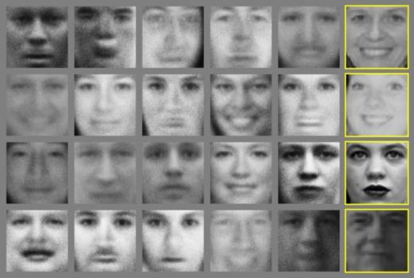

# 5 Experiments

> Section 8 of 12 from [28 - Generative Adversarial Nets](../../papers/28-generative-adversarial-nets.md) · `experiments` · pages 4-6

We trained adversarial nets an a range of datasets including MNIST\[23\], the Toronto Face Database (TFD) \[28\], and CIFAR-10 \[21\]. The generator nets used a mixture of rectifier linear activations \[19, 9\] and sigmoid activations, while the discriminator net used maxout \[10\] activations. Dropout \[17\] was applied in training the discriminator net. While our theoretical framework permits the use of dropout and other noise at intermediate layers of the generator, we used noise as the input to only the bottommost layer of the generator network.

We estimate probability of the test set data under pg by fitting a Gaussian Parzen window to the samples generated with G and reporting the log-likelihood under this distribution. The σ parameter

Model MNIST TFD DBN \[3\] 138 ± 2 1909 ± 66 Stacked CAE \[3\] 121 ± 1.6 2110 ± 50 Deep GSN \[6\] 214 ± 1.1 1890 ± 29 Adversarial nets 225 ± 2 2057 ± 26

Table 1: Parzen window-based log-likelihood estimates. The reported numbers on MNIST are the mean loglikelihood of samples on test set, with the standard error of the mean computed across examples. On TFD, we computed the standard error across folds of the dataset, with a different σ chosen using the validation set of each fold. On TFD, σ was cross validated on each fold and mean log-likelihood on each fold were computed. For MNIST we compare against other models of the real-valued (rather than binary) version of dataset.

of the Gaussians was obtained by cross validation on the validation set. This procedure was introduced in Breuleux et al. \[8\] and used for various generative models for which the exact likelihood is not tractable \[25, 3, 5\]. Results are reported in Table 1. This method of estimating the likelihood has somewhat high variance and does not perform well in high dimensional spaces but it is the best method available to our knowledge. Advances in generative models that can sample but not estimate likelihood directly motivate further research into how to evaluate such models.

In Figures 2 and 3 we show samples drawn from the generator net after training. While we make no claim that these samples are better than samples generated by existing methods, we believe that these samples are at least competitive with the better generative models in the literature and highlight the potential of the adversarial framework.

a) b)

c) d)

Figure 2: Visualization of samples from the model. Rightmost column shows the nearest training example of the neighboring sample, in order to demonstrate that the model has not memorized the training set. Samples are fair random draws, not cherry-picked. Unlike most other visualizations of deep generative models, these images show actual samples from the model distributions, not conditional means given samples of hidden units. Moreover, these samples are uncorrelated because the sampling process does not depend on Markov chain mixing. a) MNIST b) TFD c) CIFAR-10 (fully connected model) d) CIFAR-10 (convolutional discriminator and “deconvolutional” generator)

Figure 3: Digits obtained by linearly interpolating between coordinates in z space of the full model.

Deep directed graphical models

Deep undirected graphical models

Generative autoencoders Adversarial models

Inference needed during training. MCMC needed to approximate partition function gradient.

Enforced tradeoff between mixing and power of reconstruction generation

Synchronizing the discriminator with the generator. Helvetica.

Training Inference needed during training.

Learned approximate inference

Learned approximate inference

Variational inference

MCMC-based inference

Inference

Sampling No difficulties Requires Markov chain

Requires Markov chain No difficulties

Not explicitly represented, may be approximated with Parzen density estimation

Not explicitly represented, may be approximated with Parzen density estimation

Intractable, may be approximated with AIS

Intractable, may be approximated with AIS

Evaluating p(x)

Any differentiable function is theoretically permitted

Any differentiable function is theoretically permitted

Nearly all models incur extreme difficulty

Careful design needed to ensure multiple properties

Model design

Table 2: Challenges in generative modeling: a summary of the difficulties encountered by different approaches to deep generative modeling for each of the major operations involving a model.

---

Full document: [28 - Generative Adversarial Nets](../../papers/28-generative-adversarial-nets.md) · Page-level evidence: [paper-pages/28-generative-adversarial-nets](../../paper-pages/28-generative-adversarial-nets/index.md)
