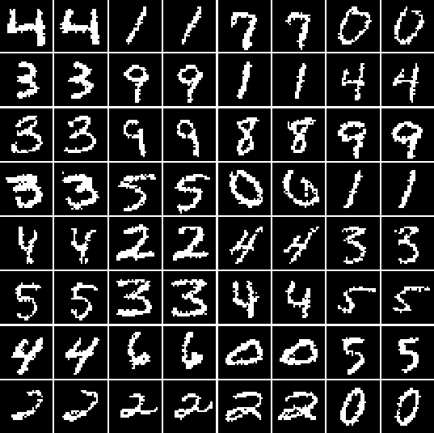
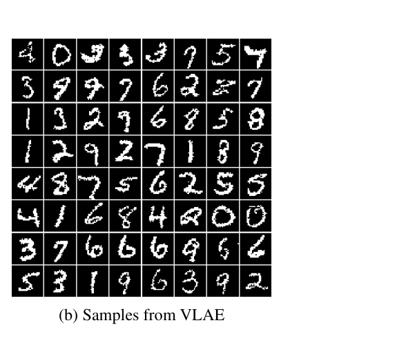
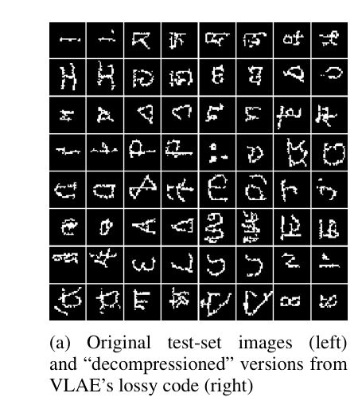
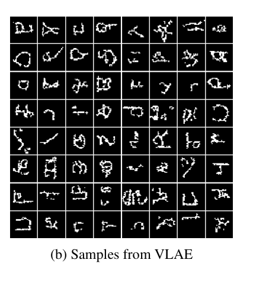
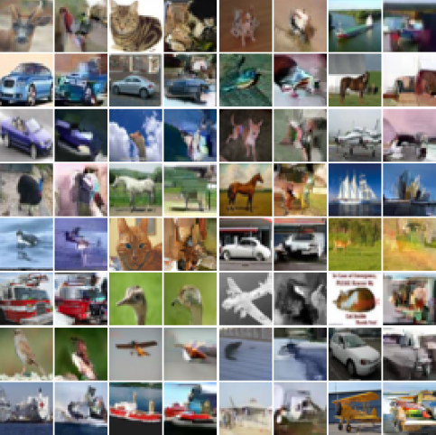
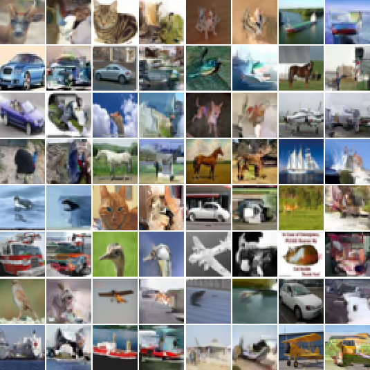
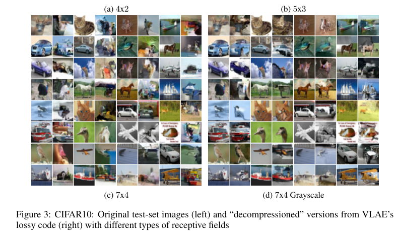
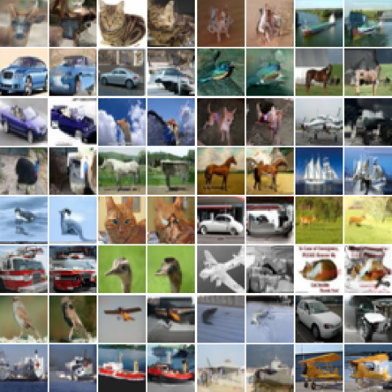

# 4 EXPERIMENTS

> Section 6 of 14 from [29 - Variational Lossy Autoencoder](../../papers/29-variational-lossy-autoencoder.md) · `experiments` · pages 5-9

In this paper, we evaluate VLAE on 2D images and leave extensions to other forms of data to future work. For the rest of the section, we define a VLAE model as a VAE that uses AF prior and autoregressive decoder. We choose to implement conditional distribution p(x|z) with a smallreceptive-field PixelCNN (van den Oord et al., 2016a), which has been proved to be a scalable autoregressive model.

For evaluation, we use binary image datasets that are commonly used for density estimation tasks: MNIST (LeCun et al., 1998) (both statically binarized 1 and dynamically binarized version (Burda et al., 2015a)), OMNIGLOT (Lake et al., 2013; Burda et al., 2015a) and Caltech-101 Silhouettes (Marlin et al., 2010). All datasets uniformly consist of 28x28 binary images, which allow us to use a unified architecture. VAE networks used in binary image datasets are simple variants of ResNet VAEs described in (Salimans et al., 2014; Kingma et al., 2016). For the decoder, we use a variant of PixelCNN that has 6 layers of masked convolution with filter size 3, which means the window of dependency, xWindowAround(i), is limited to a small local patch. During training, ”free bits” (Kingma et al., 2016) is used improve optimization stability. Experimental setup and hyperparameters are detailed in the appendix. Reported marginal NLL is estimated using Importance Sampling with 4096 samples.

We designed experiments to answer the following questions:

• Can VLAE learn lossy codes that encode global statistics?

• Does using AF priors improves upon using IAF posteriors as predicted by theory?

• Does using autoregressive decoding distributions improve density estimation performance?

4.1 LOSSY COMPRESSION

First we are interested in whether VLAE can learn a lossy representation/compression of data by using the PixelCNN decoder to model local statistics. We trained VLAE model on Statically Binarized MNIST and the converged model has E\[DKL(q(z|x)||p(z))\] = 13.3 nats = 19.2 bits, which is the number of bits it uses on average to encode/compress one MNIST image. By comparison, an identical VAE model with factorized decoding distribution will uses on average 37.3 bits in latent code, and this thus indicates that VLAE can learn a lossier compression than a VAE with regular factorized conditional distribution.

The next question is whether VLAE’s lossy compression encodes global statistics and discards local statistics. In Fig 1a, we visualize original images xdata and one random “decompression” xdecompressed from VLAE: z ∼q(z|xdata), xdecompressed ∼p(x|z). We observe that none of the

1We use the version provided by Hugo Larochelle.

6

Published as a conference paper at ICLR 2017

(a) Original test-set images (left) and “decompressioned” versions from VLAE’s lossy code (right)

(b) Samples from VLAE

Figure 1: Statically Binarized MNIST

decompressions is an exact reconstruction of the original image but instead the global structure of the image was encoded in the lossy code z and regenerated. Also worth noting is that local statistics are not preserved but a new set of likely local statistics are generated in the decompressed images: the binary masks are usually different and local styles like stroke width are sometimes slightly different.

However, we remark that the lossy code z doesn’t always capture the kind of global information that we care about and it’s dependent on the type of constraint we put on the decoder. For instance, in Fig 4b, we show decompressions for OMNIGLOT dataset, which has more meaningful variations in small patches than MNIST, and we can observe that semantics are not preserved in some cases. This highlights the need to specify the type of statistics we care about in a representation, which will be different across tasks and datasets, and design decoding distribution accordingly.

(a) Original test-set images (left) and “decompressioned” versions from VLAE’s lossy code (right)

(b) Samples from VLAE

Figure 2: OMNIGLOT

4.2 DENSITY ESTIMATION

Next we investigate whether leveraging autoregressive models as latent distribution p(z) and as decoding distribution p(x|z) would improve density estimation performance.

To verify whether AF prior is able to improve upon IAF posterior alone, it’s desirable to test this model without using autoregressive decoder but instead using the conventional independent Bernoulli distribution for p(x|z). Hence we use the best performing model from Kingma et al.

7

Published as a conference paper at ICLR 2017

Table 1: Statically Binarized MNIST

Model NLL Test Normalizing flows (Rezende & Mohamed, 2015) 85.10 DRAW (Gregor et al., 2015) < 80.97 Discrete VAE (Rolfe, 2016) 81.01 PixelRNN (van den Oord et al., 2016a) 79.20 IAF VAE (Kingma et al., 2016) 79.88 AF VAE 79.30 VLAE 79.03

(2016) on statically binarized MNIST and make the single modification of replacing the original IAF posterior with an equivalent AF prior, removing the context. As seen in Table 1, VAE with AF prior is outperforming VAE with an equivalent IAF posterior, indicating that the deeper generative model from AF prior is beneficial. A similar gain carries over when an autoregressive decoder is used: on statically binarized MNIST, using AF prior instead of IAF posterior reduces train NLL by 0.8 nat and test NLL by 0.6 nat.

Next we evaluate whether using autoregressive decoding distribution can improve performance and we show in Table 1 that a VLAE model, with AF prior and PixelCNN conditional, is able to outperform a VAE with just AF prior and achieves new state-of-the-art results on statically binarized MNIST.

In addition, we hypothesize that the separation of different types of information, the modeling global structure in latent code and local statistics in PixelCNN, likely has some form of good inductive biases for 2D images. In order to evaluate if VLAE is an expressive density estimator with good inductive biases, we will test a single VLAE model, with the same network architecture, on all binary datasets. We choose hyperparameters manually on statically binarized MNIST and use the same hyperparameters to evaluate on dynamically binarized MNIST, OMNIGLOT and Caltech-101 Silhouettes. We also note that better performance can be obtained if we individually tune hyperparameters for each dataset. As a concrete demonstration, we report the performance of a fine-tuned VLAE on OMNIGLOT dataset in Table 3.

Table 2: Dynamically binarized MNIST

Model NLL Test Convolutional VAE + HVI (Salimans et al., 2014) 81.94 DLGM 2hl + IWAE (Burda et al., 2015a) 82.90 Discrete VAE (Rolfe, 2016) 80.04 LVAE (Kaae Sønderby et al., 2016) 81.74 DRAW + VGP (Tran et al., 2015) < 79.88 IAF VAE (Kingma et al., 2016) 79.10 Unconditional Decoder 87.55 VLAE 78.53

Table 3: OMNIGLOT. \[1\] (Burda et al., 2015a), \[2\] (Burda et al., 2015b), \[3\] (Gregor et al., 2015), \[4\] (Gregor et al., 2016),

Table 4: Caltech-101 Silhouettes. \[1\] (Bornschein & Bengio, 2014), \[2\] (Cho et al., 2011), \[3\] (Du et al., 2015), \[4\] (Rolfe, 2016), \[5\] (Goessling & Amit, 2015),

Model NLL Test VAE \[1\] 106.31 IWAE \[1\] 103.38 RBM (500 hidden) \[2\] 100.46 DRAW \[3\] < 96.50 Conv DRAW \[4\] < 91.00 Unconditional Decoder 95.02 VLAE 90.98 VLAE (fine-tuned) 89.83

Model NLL Test RWS SBN \[1\] 113.3 RBM \[2\] 107.8 NAIS NADE \[3\] 100.0 Discrete VAE \[4\] 97.6 SpARN \[5\] 88.48 Unconditional Decoder 89.26 VLAE 77.36

8

Published as a conference paper at ICLR 2017

As seen in Table 2,3,4, with the same set of hyperparameters tuned on statically binarized MNIST, VLAE is able to perform well on the rest of datasets, significantly exceeding previous state-ofthe-art results on dynamically binarized MNIST and Caltech-101 Silhouettes and tying statistically with best previous result on OMNIGLOT. In order to isolate the effect of expressive PixelCNN as decoder, we also report performance of the same PixelCNN trained without VAE part under the name “Unconditional Decoder”.

4.3 NATURAL IMAGES: CIFAR10

In addition to binary image datasets, we have applied VLAE to the CIFAR10 dataset of natural images. Density estimation of CIFAR10 images has been a challenging benchmark problem used by many recent generative models and hence is great task to position VLAE among existing methods.

We investigated using ResNet (He et al., 2016) and DenseNet (Huang et al., 2016) as building blocks for VAE networks and observed that DenseNet reduces overfitting. We also propose a new optimization technique that blends the advantages of KL annealing (Serban et al., 2016) and ”free bits” (Kingma et al., 2016) to stabilize learning on this challenging dataset. Detailed experimental setup is described in Appendix.

VLAE is compared to other methods on CIFAR10 in Table 5. We show that VLAE models attain new state-of-the-art performance among other variationally trained latent-variable models. DenseNet VLAE model also outperforms most other tractable likelihood models including Gated PixelCNN and PixelRNN and has results only slightly worse than currently unarchived state-of-the-art PixelCNN++.

Table 5: CIFAR10. Likelihood for VLAE is approximated with 512 importance samples. \[1\] (van den Oord et al., 2016a), \[2\] (Dinh et al., 2014), \[3\] (van den Oord & Schrauwen, 2014), \[4\] (Dinh et al., 2016), \[5\] (van den Oord et al., 2016b), \[6\] (Salimans et al., 2017), \[7\] (Sohl-Dickstein et al., 2015), \[8\] (Gregor et al., 2016), \[9\] (Kingma et al., 2016)

Method bits/dim ≤ Results with tractable likelihood models: Uniform distribution \[1\] 8.00 Multivariate Gaussian \[1\] 4.70 NICE \[2\] 4.48 Deep GMMs \[3\] 4.00 Real NVP \[4\] 3.49 PixelCNN \[1\] 3.14 Gated PixelCNN \[5\] 3.03 PixelRNN \[1\] 3.00 PixelCNN++ \[6\] 2.92 Results with variationally trained latent-variable models: Deep Diffusion \[7\] 5.40 Convolutional DRAW \[8\] 3.58 ResNet VAE with IAF \[9\] 3.11 ResNet VLAE 3.04 DenseNet VLAE 2.95

We also investigate learning lossy codes on CIFAR10 images. To illustrate how does the receptive field size of PixelCNN decoder influence properties of learned latent codes, we show visualizations of similar VLAE models with receptive fields of different sizes. Specifically we say a receptive field, xWindowAround(i), has size AxB when a pixel xi can depend on the rectangle block of size AxB immediately on top of xi as well as the

 A−1

2 

pixels immediately to the left of xi. We use this notation to refer to different types of PixelCNN decoders in Figure 3.

From (a)-(c) in Figure 3, we can see that larger receptive fields progressively make autoregressive decoders capture more structural information. In (a), a smaller receptive field tends to preserve rather detailed shape information in the lossy code whereas the latent code only retains rough shape in (c) with a larger receptive field.

9

Published as a conference paper at ICLR 2017

(a) 4x2

(b) 5x3

(c) 7x4

(d) 7x4 Grayscale

Figure 3: CIFAR10: Original test-set images (left) and “decompressioned” versions from VLAE’s lossy code (right) with different types of receptive fields

It’s interesting to also note that in (a)-(c), oftentimes color information is partially omitted from latent codes and one explanation can be that color is very predictable locally. However, color information can be important to preserve if our task is, for example, object classification. To demonstrate how we can encode color information in the lossy code, we can choose to make PixelCNN decoder depend only on images’ grayscale versions. In other words, instead of choosing the decoder to be plocal(x|z) = Q

i p(xi|z, xWindowAround(i)), we use a decoder of the form plocal(x|z) = Q

i p(xi|z, Grayscale(xWindowAround(i))). In (d) of Figure 3, we visualize lossy codes for a VLAE that has the same receptive field size as (c) but uses a “grayscale receptive field”. We note that the lossy codes in (d) encode roughly the same structural information as those in (c) but generally generate objects that are more recognizable due to the preservation of color information. This serves as one example of how we can design the lossy latent code carefully to encode what’s important and what’s not.

---

Full document: [29 - Variational Lossy Autoencoder](../../papers/29-variational-lossy-autoencoder.md) · Page-level evidence: [paper-pages/29-variational-lossy-autoencoder](../../paper-pages/29-variational-lossy-autoencoder/index.md)
