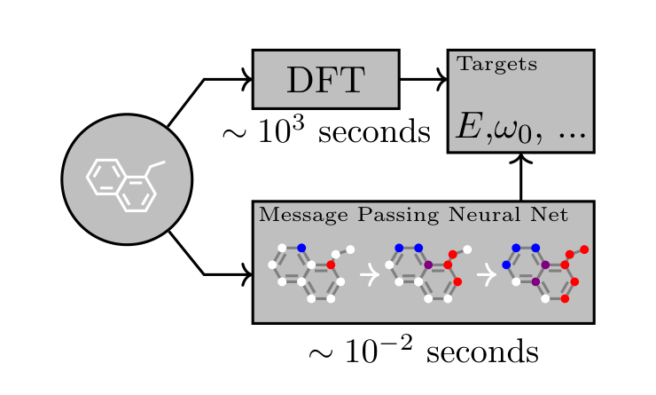

# Front matter

> Section 1 of 21 from [30 - Neural Message Passing for Quantum Chemistry](../../papers/30-neural-message-passing-for-quantum-chemistry.md) · `front-matter` · pages 1-1

The text below was extracted programmatically from the published PDF, page by page, with figures kept inline where they appear. `<!-- page N -->` comments mark the original page boundaries. Mathematical notation is preserved as plain text rather than LaTeX, so equations read approximately rather than exactly.[^original]

## Neural Message Passing for Quantum Chemistry

Justin Gilmer 1 Samuel S. Schoenholz 1 Patrick F. Riley 2 Oriol Vinyals 3 George E. Dahl 1

### Abstract Supervised learning on molecules has incredible potential to be useful in chemistry, drug discovery, and materials science. Luckily, several promising and closely related neural network models invariant to molecular symmetries have already been described in the literature. These models learn a message passing algorithm and aggregation procedure to compute a function of their entire input graph. At this point, the next step is to find a particularly effective variant of this general approach and apply it to chemical prediction benchmarks until we either solve them or reach the limits of the approach. In this paper, we reformulate existing models into a single common framework we call Message Passing Neural Networks (MPNNs) and explore additional novel variations within this framework. Using MPNNs we demonstrate state of the art results on an important molecular property prediction benchmark; these results are strong enough that we believe future work should focus on datasets with larger molecules or more accurate ground truth labels.

Targets

## DFT ⇠103 seconds

## E,!0, ...

Message Passing Neural Net

## ⇠10−2 seconds

Figure 1. A Message Passing Neural Network predicts quantum properties of an organic molecule by modeling a computationally expensive DFT calculation.

Rupp et al., 2012; Rogers & Hahn, 2010; Montavon et al., 2012; Behler & Parrinello, 2007; Schoenholz et al., 2016) has revolved around feature engineering. While neural networks have been applied in a variety of situations (Merkwirth & Lengauer, 2005; Micheli, 2009; Lusci et al., 2013; Duvenaud et al., 2015), they have yet to become widely adopted. This situation is reminiscent of the state of image models before the broad adoption of convolutional neural networks and is due, in part, to a dearth of empirical evidence that neural architectures with the appropriate inductive bias can be successful in this domain.

---

Full document: [30 - Neural Message Passing for Quantum Chemistry](../../papers/30-neural-message-passing-for-quantum-chemistry.md) · Page-level evidence: [paper-pages/30-neural-message-passing-for-quantum-chemistry](../../paper-pages/30-neural-message-passing-for-quantum-chemistry/index.md)
